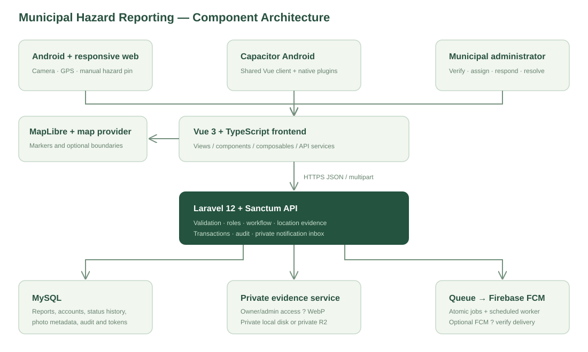
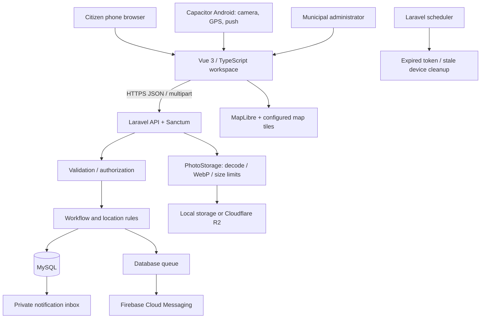
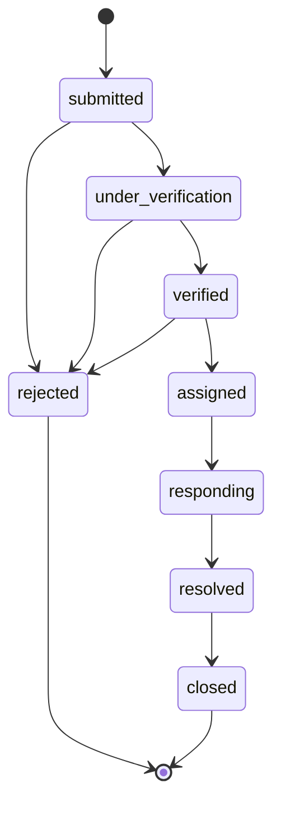

# 02 — System architecture and source structure

## Accepted technology baseline

The [12 November shared-interface and workflow update](REUSABLE_WORKFLOWS_2026-11-12.md) centralizes modal/form/table controls, adds administrator-managed departments/category routing, provides visible CSV seed catalogs with one configured seed entry point, and adds one-time saved-code password recovery. Community coordinate editing is replaced by confirmed map-pin actions. Server JSON remains authoritative for validation; floating feedback does not consume modal layout space. Social sharing exports only reviewed public fields, with copied Facebook captions and a deployed public link needed for crawler previews.

On 12 November 2026, the user confirmed that Ajhon10/MuniAlert should remain a **public source repository** and authorized pushing the current changes. This supersedes the earlier private-source preference described below. Public source access does not publish environment files, incident records, private evidence or credentials and does not deploy the application.

The user selected one private `Ajhon10/MuniAlert` GitHub workspace repository on 9 November 2026 for team testing. The Vue client and Laravel server remain separate applications in `hazard-client/` and `hazard-server/`; shared tests, capstone documentation and deployment examples live at the root. Earlier local Git histories are preserved in ignored backups. This repository consolidation does not change the accepted stack or hosting architecture. Web releases package Vue inside Laravel’s public directory for one-origin Hostinger deployment. The confirmed deployment target is Hostinger Web/Cloud hosting, with Android plus responsive web as clients. See [the selected hosting guide](HOSTINGER_WEB_CLOUD.md), [stack review](STACK_AND_HOSTINGER.md) and [team setup](TEAM_TESTING.md).

Vue 3 + TypeScript + Vite provides the client application. Capacitor packages the same client for Android. Laravel 12 exposes the REST API, Sanctum authenticates requests, and MySQL persists application data. MapLibre renders the map; a configurable tile/style provider supplies cartography. Laravel Filesystem stores evidence on a private local evidence disk or an operator-verified private Cloudflare R2 bucket. Authenticated media requests authorize each report/photo; original files are never published by the UI. Database notifications work independently of Firebase; a queued job can send FCM HTTP v1 messages when configured.

The client now presents role-specific navigation: citizens see reporting, verified news, notifications and their profile; administrators see report review, content management and their profile. The API independently checks roles for every privileged mutation. A public settings endpoint supplies approved hotlines and the initial map center. Public discovery requires factual acceptance; news additionally requires explicit publication of a reviewed public title/summary; citizen comments and reactions are stored separately. Achievement badges are calculated from verified report counts and their definitions are managed by administrators. The Philippine clock is formatted in the browser with the `Asia/Manila` time zone and updates every second.





## Repository structure

```text
BANTAY/
├── hazard-client/
│   ├── src/
│   │   ├── views/DashboardView.vue      # Workspace composition
│   │   ├── components/                # Map, report form, auth, detail, dialog
│   │   ├── composables/useDashboard.ts # Workspace state and actions
│   │   ├── services/                  # HTTP, media/GPS, push integrations
│   │   ├── config/api.ts              # Configured API server origin
│   │   ├── types/index.ts             # Typed API/domain contracts
│   │   ├── data/demo.ts               # Explicit fictional preview fixtures
│   │   └── assets/main.css            # Responsive UI styles
│   ├── android/                      # Capacitor native project
│   └── capacitor.config.ts
├── hazard-server/
│   ├── app/Http/Controllers/Api/      # HTTP orchestration
│   ├── app/Http/Requests/             # Input validation
│   ├── app/Http/Resources/            # Public/private JSON projection
│   ├── app/Models/                    # Eloquent entities and relations
│   ├── app/Services/PhotoStorage.php  # Image processing/storage boundary
│   ├── app/Support/                   # Location mathematics, status rules
│   ├── app/Jobs/SendReportPush.php    # Queued FCM delivery
│   ├── app/Console/Commands/          # Administrator provisioning
│   ├── database/migrations/          # Canonical schema
│   ├── database/seeders/             # Categories/departments only
│   ├── routes/                       # API, web auth, scheduler registration
│   └── tests/Feature/                 # Isolated workflow/security tests
├── deployment/                       # Nginx, worker and environment guidance
├── documentation/                    # Capstone and operational attachments
├── scripts/                          # Verification, test server, docs build
├── tests/                            # Playwright browser tests
├── hazard-client/.github/workflows/  # Client verification
├── hazard-server/.github/workflows/  # Server verification
├── AGENTS.md / MEMORY.md / TASKS.md
└── package.json
```

## Principles adapted from PDEA

The reference was read from the existing local `PDEA/pdea-server` and `PDEA/pdea-client` source, including `composer.json`, `routes/api.php`, `app/Services/FileStorageService.php`, `tests/Feature/SecurityHardeningTest.php`, `src/config/api.ts`, `src/services/authService.ts`, and the frontend `views`, `layout`, and `composables` directories. PDEA's historical architecture HTML labels itself historical, so current source took precedence.

| Reference principle | Application in Bantay |
| --- | --- |
| Separate Vue client and Laravel server | Independent `hazard-client/` and `hazard-server/` roots |
| API controller namespace | `Http/Controllers/Api` with Sanctum-protected routes |
| Storage isolated behind service/config | Active `PhotoStorage` and configured local/R2 disk |
| Shared frontend API configuration and services | `config/api.ts`, `services/api.ts`, device integration services |
| Reusable frontend logic and components | `composables/useDashboard.ts`, components, workspace view |
| Role checks and security feature tests | Owner/admin privacy, role enforcement, token and workflow tests |
| Migrations and operational handover | Versioned schema, deployment guide, task/release records |

PDEA's domain-specific museum modules, data, credentials, DigitalOcean settings, legacy bootstrap layout, and historical deployment details were not copied. Bantay uses the Laravel 12 application skeleton and its accepted R2/MySQL design. The single workspace uses local view state rather than PDEA's larger multi-page router structure.

## Report submission sequence

```mermaid
sequenceDiagram
    actor C as Citizen
    participant V as Vue / Capacitor
    participant A as Laravel API
    participant S as Photo storage
    participant D as MySQL
    C->>V: Add category, photos and description
    V->>V: Compress photo; get GPS or manual pin
    C->>V: Confirm selected location
    V->>A: Look for same-category nearby reports
    A->>D: Active reports within six-hour/latitude filter
    A-->>V: Candidates within 100 meters
    C->>V: Confirm duplicate or submit new report
    V->>A: Authenticated multipart submission
    A->>A: Validate fields, GPS source, confirmation, files
    A->>S: Re-encode and store WebP photos
    A->>D: Transaction: report, photo metadata, history, audit
    A-->>V: Reference number and submitted status
```

If persistence fails after photos are stored, the application attempts to delete those newly stored objects. Operational monitoring should check for orphaned objects if a storage provider is unavailable during cleanup.

## Interview-aligned records and privacy ? 8 November 2026

Android phones are the primary client; responsive web remains supported. The existing custom Vue UI is retained; Vuetify is not installed or required. The Filipino interview supports private evidence, simple instructions, safe emergency calling and periodic incident records. See the [source-by-source review](INTERVIEW_ALIGNMENT_2026-11-08.md).

Raw titles/descriptions, exact addresses/coordinates, incident observations, evidence and response history are restricted to the reporter and authorized administrators. Public lists show generic or reviewed titles, separate reviewed summaries, barangay and coordinates rounded to two decimals. Public search does not search private title/address fields. Public news requires explicit summary publication even after verification. Evidence is fetched with the existing cookie or Android bearer credential and displayed through temporary blob URLs; no token is embedded in an image URL.

`EvidenceController` validates and saves up to three resolution photos separately from incident evidence, locks the report before checking status/count, and records an audit. `AnalyticsController` aggregates all matching records in SQL by PHT day, then regroups at most 366 daily rows into weeks/months. Incident time is used when supplied; otherwise submission time is explicitly identified as a fallback. Summaries count reports, including unverified ones, and exclude rejected/deleted records. They do not establish unique incidents, injuries or causes.

## State model



An administrator may add notes or adjust nonterminal records without changing the current status. Closed and rejected reports are terminal. Verification requires verified coordinates; assignment requires a responder/team. Updates lock the database row, validate the transition, and write history, audit and the citizen notification transactionally. When FCM is configured, one database job per registered device is inserted on the same database before commit. Report changes, history, audit, inbox and queue insertion therefore commit or roll back together. The report-push worker retries each device independently; delivery remains at least once across a provider-accepted/worker-crash boundary.

## Location model

`gps_latitude`, `gps_longitude`, and `gps_accuracy` describe one requested device reading. `selected_latitude`/`selected_longitude` describe the citizen's hazard pin. `verified_latitude`/`verified_longitude` describe the administrator's review. These are not continuous device tracking.

`location_source` is `gps`, `gps_adjusted`, or `manual`. The server rejects a `gps` label when the pin differs from GPS beyond a one-millionth-degree tolerance. A GPS-to-pin distance above 250 meters or reported GPS accuracy worse than 100 meters prompts review. These configurable heuristics do not prove accuracy, fraud, or invalidity.

The Haversine formula calculates approximate distance in meters. A latitude-band/category/time query reduces nearby candidates before distance filtering. There is no PostGIS dependency and no claim of survey-grade precision.

## Authentication boundaries

Local demo identities are explicitly provisioned with `DemoAccountSeeder`, outside normal reference seeding. The configurable administrator email defaults to `admin@example.test`; two citizen identities use `example.test`. All three passwords are private per-install configuration, validated before transactional creation; existing accounts stay unchanged. See [test accounts](TEST_ACCOUNTS.md). A shared password-input boundary prevents bcrypt overflow/truncation and malformed email casts. Global `SecurityHeaders` middleware applies response/cache protections and production debug/cookie guards. See [the phased security plan](SECURITY_IMPLEMENTATION_PLAN.md) for unimplemented MFA, CSP and operational controls.

Web clients obtain Laravel's CSRF cookie and retain HttpOnly session/remember cookies plus a registered encrypted per-device proof. Session state has a configurable lifetime (default 90 days), while the device proof can rebuild authenticated/MFA state after closure without granting recent-action verification. Browser/OS storage retention still applies. Android uses Capacitor secure-storage 7.1.3 and Android Keystore; native credentials default to no automatic expiry with AUTH_PERSISTENT_LOGIN=true. The optional expiring policy still checks expiry before renewal. Logout revokes the current device; password/security changes revoke affected tokens/registrations. Login and credential changes lock the user row. Public registration cannot grant administrator authority, and private history/GPS remain owner/admin protected. See [the continuation](SECURITY_PHASE_3_DASHBOARD_2026-11-10.md) and [Laravel Sanctum](https://laravel.com/docs/12.x/sanctum).

## Scheduled push on the selected hosting plan

With `HAZARD_SCHEDULED_PUSH=true`, the hPanel scheduler cron runs a CLI-only `hazard:work-push` batch every permitted minute. A database lock prevents overlapping scheduled workers; each batch exits after three jobs or a 30-second between-job budget. Jobs remain durable in the same application database. The 180-second worker lock recovers after a killed process; reserved jobs can retry after 90 seconds. Missing Firebase configuration preserves pending jobs. OAuth requests are bounded independently of optional PHP signal timeouts. This mode needs no persistent daemon. In-app inbox persistence remains independent of delayed FCM delivery. The real account's limits and accepted latency must still be measured.

## Google and Facebook authentication

Laravel Socialite performs provider redirects and code exchange; server-only credentials live in services configuration. Web returns to an allowlisted origin and uses Sanctum-compatible HttpOnly session/remember cookies. Android uses Capacitor App/Browser plugins, an external browser, a fixed custom-scheme callback and a 90-second one-use code protected by an S256 verifier held in native secure storage. No provider access/refresh token or Sanctum token is placed in client redirect URLs. Google also uses PKCE on the server-to-provider authorization flow. Accounts link only through explicit password confirmation and authenticated identity proof. This adds no permanent worker requirement to Hostinger Web/Cloud. See [setup and acceptance](SOCIAL_AUTH_SETUP.md).

## MuniAlert identity, local guidance and promotional authoring

The user approved the full capstone title: **Municipal Emergency and Public Hazard Reporting System with Photo and Location-Based Incident Tracking**. The selected short application name is **MuniAlert**, with subtitle **Emergency & Public Hazard Reporting**. Display names and current documentation are updated; stable Android package/auth identifiers stay compatible with existing installations and callbacks. Client identity lives in `src/config/identity.json`.

The default browser-session cookie remains `bantay_session`, independently of `APP_NAME`, so a display-name change preserves existing browser sessions. An explicitly configured `SESSION_COOKIE` is still respected. Native package ID, deep-link callback and secure-storage keys also retain their established values.

`?view=guide` loads a bundled static, searchable citizen/admin manual. It needs no new API, database, account privilege or external service. The six-step `FeatureTour` uses a native dialog, highlights real overview controls, supports back/next/skip/ESC, and can be replayed. Instructions describe only implemented behavior; public reading of administrator instructions grants no administrative access. Browser print support produces an expanded manual.

The requested Remotion video is a separate **React + TypeScript** authoring artifact under `promo-video/`, with its own lockfile and local Studio. This stack is explicitly supplied by the user through the Remotion request; it does not migrate the Vue application. The video has no backend/database/hosting requirement. The user explicitly requested **MP4 plus editable preview**. Use synthetic demonstration screens and locally generated narration/music, with no credentials or real incident evidence in public video assets. Local source, rendered media, deployment and physical-device acceptance remain distinct.

At the user's request, narration now matches KIKOS Order Planner's generic Kokoro `af_heart` preset and q8 model. The separate video project carries the pinned speech tools and generated WAVs; large model files stay in an ignored local cache and are unnecessary for preview/rendering. The source gate verifies voice/clip hashes and scene timing. See [narration reproduction](../promo-video/NARRATION.md).

## Basista map and service area — 9 November 2026

The user confirmed **Basista Municipal Hall, Pangasinan**, covering Anambongan, Bayoyong, Cabeldatan, Dumpay, Malimpec East, Mapolopolo, Nalneran, Navatat, Obong, Osmeña Sr., Palma, Patacbo and Poblacion. Client `config/municipality.json` and server `config/municipality.php` define the same 13 names, verified by the integration documentation check. New reports use this allowlist; case/ASCII variants normalize to the canonical spelling. Existing incident records are preserved. Reference geometry is not a legal geofence: the form warns about pins outside the reference extent but does not infer legal jurisdiction or overwrite GPS.

The existing MapLibre renderer now offers Clear (OpenFreeMap Positron), Streets (OpenStreetMap raster), Dark (OpenFreeMap Dark), and an optional configured municipal style. Preferences store only display mode and boundary booleans in guarded browser storage. Changing style retains the map camera, report markers, selected incident pin and original GPS; `style.load` reinstalls enabled boundary layers. Quiet report refreshes with unchanged locations retain the camera. The map's category selector shares the dashboard filter/query, and overview/map expansion preserves filters. Map pagination explicitly covers report pages rather than implying all database records are loaded.

Bundled GeoJSON provides 13 detailed Basista barangays, six nearby city/municipality outlines and Pangasinan province context (approximately 102 KB total uncompressed). These public geographic assets are separate from private incident evidence. Names appear as zoom-dependent labels; overlays have separate switches, colors and line styles. The worker requests local files only when enabled, while basemap tiles/fonts still need network access. `VITE_BARANGAY_GEOJSON_URL`, `VITE_CITY_GEOJSON_URL` and `VITE_PROVINCE_GEOJSON_URL` can replace the reference files with approved data. See [map source and acceptance notes](BASISTA_MAP_2026-11-09.md).

The camera migration changes only the former generic Manila center to Basista; it retains customized camera settings and never edits users or reports. This is source implementation and local verification, not field boundary acceptance or Android hardware certification.

## Compact header and team publication — 9 November 2026

Compact widths (up to 1023 CSS pixels) use bottom **More** as their navigation entry; the redundant header menu is removed. The header shows the app name, Settings action, connection indicator and account. Clock/page context remains in the content heading. Desktop utilities share the page-heading row, with no dedicated blank toolbar row. A shared `WorkspaceHeader` renders in the appropriate location when the breakpoint changes. The header uses a solid reading surface so scrolling manual text does not bleed through the decorative material. Keyboard drawer dismissal restores focus to More.

The compact header attaches to the viewport's top edge with no forced margin or sticky breathing offset. Real device safe-area padding is inside the header surface, rather than an empty band above it. Desktop heading placement is unchanged by this compact-only rule.

Native modal dialogs use three flex regions: a fixed header, one keyboard-focusable scrolling body and a fixed named footer slot. Authentication and report components own their modal so their reactive actions can populate that footer directly. Footer submit buttons associate with uniquely identified forms, preserving browser validation and Enter submission. Nested confirmations share a reference-counted body-scroll lock. The outer dialog clips overflow to prevent photo/focus changes from scrolling its chrome. The feature-tour sheet uses the same header/body/footer pattern. The viewport requests content resizing for Android's onscreen keyboard; real-device behavior remains an acceptance check.

The root pre-push hook runs the complete gate and rejects an uncommitted publication state. CI checks the same workspace using PHP 8.5 and Node 22, including source-publication safety and the separate Remotion lint/audit. A manual Android debug-APK workflow accepts only a public HTTPS API origin without credentials. GitHub source access does not host the API or establish physical-device acceptance. The fraud guide separates existing verification/rate-limit controls from proposed contact verification and account moderation; no automatic fraud classifier was introduced.

Collaborators can run an independent local website from the tracked source, lockfiles, environment examples and migrations. They create their own environment/key/database/accounts; original owner environment files, database dumps and evidence are not runtime dependencies. Android Chrome uses the PC development site through USB forwarding. An installed APK or a phone-only remote test additionally needs an actually reachable HTTPS backend. The [first-download quickstart](COLLABORATOR_QUICKSTART.md) and [file handoff checklist](COLLABORATOR_FILE_CHECKLIST.md) distinguish these routes and optional cloud integrations.

## Reading and action feedback — 10 November 2026

The client uses a shared `services/feedback.ts` store and component-scoped feedback watchers, rendered by `ToastHost`/`ToastMessage`. Native modal dialogs make the surrounding page inert; the host relocates messages to the active open dialog and gives them bounded layout space above its scrolling body. Success/info timers pause during focus, hover or document hiding. Validation uses a single persistent toast with field descriptions, focus and Go to field where applicable; duplicate inline errors and the native validation bubble are suppressed. Clearing/leaving a source removes its stale error. Only the latest four messages are kept. PasswordInput provides independent, temporary visibility controls while preserving native input constraints/autocomplete. No toast or password-visibility data is persisted or sent to another service. See [the refinement and schema inventory](TOAST_PASSWORD_SCHEMAS_2026-11-11.md).

`services/accessibility.ts` validates display preferences and keeps per-account local caches, with a separate guest cache. Root classes and relative font units apply text size, boldness, contrast, spacing and reduced motion throughout existing screens. The native text-size slider supports every 5% step from 100–200%, with local drag preview and app-wide commit on release. A shared reactive motion preference combines OS and user settings. Dashboard `RollingNumber` uses cancellable browser animations on vertical digit strips; other `AnimatedNumber` summaries retain cancellable requestAnimationFrame count-up. Both expose a separate accurate final value to assistive technology. Signed-in preferences now sync through the authenticated reading-preferences API; see the 11 November Settings extension below. See [the original record](ACCESSIBILITY_FEEDBACK_2026-11-10.md) and [slider/reel follow-up](SLIDER_ROLLING_NUMBERS_2026-11-10.md).

## Phase 2 identity and Phase 3 checks — 10 November 2026

`AccountMfa` owns limited login/enrollment challenges; `SecuritySessions` owns full credential issuance, versions and recent verification. Password and social/native paths converge on that decision. `RequireSecureAccount` checks every authenticated route and rejects old password-only administrator credentials. MFA verification locks the user then challenge row, consumes monotonically newer time steps or hashed recovery codes, and rejects changed/expired state. Enrollment requires separate operator authorization.

`AccountRecovery` inserts a private encrypted delivery proof and ID-only `SendSecurityMail` job in the same database transaction on the `security-mail` connection. The bounded scheduled worker rechecks authority/expiry and never uses a log mailer in real deployment. Local email verification is separate from provider email assertions. Reset revokes credentials but retains MFA. Web tokens remain HttpOnly; native full credentials enter the secure vault only after MFA.

Production Vite builds emit CSP meta/static headers and a policy manifest reused by Laravel. UploadProtection scans original/re-encoded bytes through a bounded ClamAV adapter when configured and rejects unavailable/infected scans. Quarantine is private and bounded. SecurityEvents stores only names, private IDs, timestamps and keyed source hashes. PHPStan/Larastan, strict TypeScript, CSP tests and pinned/redacted Gitleaks extend the exact-state gate. See [implementation](SECURITY_PHASE_2_2026-11-10.md) and [activation/remaining operations](SECURITY_OPERATIONS_2026-11-10.md).

## Durable device access and dashboard decoration

`WebDeviceSessions` stores hashed, per-device browser proofs with credential version/MFA state. `RestoreDeviceLogin` runs after session startup and before auth, checks current authority, regenerates the session and restores access without recent-action proof. Native credentials default to no automatic expiry, retaining secure storage and revocation. `DashboardBackgroundController` serves only the current approved WebP from private branding storage; administrator mutations use recent verification and redacted events. `usePageMotion` animates entry without remounting the map. `SecurityMonitor` provides aggregate CLI/log signals; the isolated synthetic backup rehearsal remains separate from production recovery. See [the continuation](SECURITY_PHASE_3_DASHBOARD_2026-11-10.md).

## Factual review, separate publication and private achievements

HazardReport owns communityVisible/published query scopes and predicates. ReportController uses them for public list/stats/nearby, with separate authenticated admin statistics and existing owner/admin private paths. Fact-check and post controllers lock/recheck the report before changing state, recording private review/audit metadata and reporter-safe notifications through the shared transactional ReportUpdates service. HazardResource keeps original data private regardless of the caller's role on public routes. Unpublished draft text is excluded from projections and public title searches. Frontend authority changes clear cached report/stat/selection state before loading public data.

FactCheckPanel and NewsPostComposer expose separate review and publication steps. NewsShareController renders only current published text in escaped HTML with Open Graph metadata; `/news` is proxied in development and served by Laravel in the combined deployment. HazardAchievements groups accepted reports by owner/category and applies configured 1/5/15 milestones; the UI uses category medallions, disclosure and accessible progress. No public leaderboard or duplicate per-status award rows are created. See [the continuation](COMMUNITY_REVIEW_ACHIEVEMENTS_2026-11-10.md).

The community navigation refinement removes the standalone Verified hazards destination; the dashboard/map retain accepted discovery, Verified news provides editorial updates and My reports includes every own undeleted lifecycle status. Legacy community `view=reports` links normalize to the map; administrator report review remains separate. Public post detail now includes reviewed display-name and incident-time snapshots plus safe category/area/priority/office/date/reference metadata. NewsIncidentDetails is shared by composer preview/feed; the escaped server share page uses the same contract. Private reporter records are never loaded into the public projection. See [the navigation/news refinement](COMMUNITY_NAVIGATION_NEWS_DETAILS_2026-11-10.md).

## Account settings and Gmail email — 11 November 2026

Settings owns the reading panel, guide and Account security & email. The old header/sidebar reading and guide shortcuts and community callout are removed. readingAccount serializes debounced preference saves, keeps account-specific dirty caches for retry and changes scope synchronously when identity changes. The server authenticates ownership and requires an account_id matching the current identity to reject delayed cross-account requests. Six explicit display fields are allowlisted; other profile/security state cannot be written through this endpoint.

TwoFactorInput supplies six numeric cells with whole-code paste, keyboard navigation, one-time-code autocomplete and a separate recovery-code mode. Existing TOTP, operator enrollment, replay/lockout/recent-verification controls are preserved. AccountMailDelivery admits configured TLS SMTP only outside tests; sample addresses are excluded. Gmail uses BANTAY's own credentials, never PDEA's. SendReportEmail queues only a notification UUID transactionally and rechecks current owner, active/verified/opt-in state and report existence before delivery. Bounded security-mail batches serve both security and optional report mail. See [implementation and readiness](SETTINGS_2FA_EMAIL_2026-11-11.md).

## Emergency-first reporting and private local screening

EmergencyFirst precedes authentication/report entry and reuses HotlineDirectory, whose search works without GPS. Optional permission sorts only saved agency coordinates. Assistance remains reporter-declared private state. NotificationPanel replaces a page with a native dialog; item navigation loads the report through existing authorization, marks that owned notification and opens My reports/admin review. Identity guards reject stale responses. Existing activity links open the dialog. The highlighted tour has a floating safe-area-aware launcher.

AdminReportAlerts inserts active-admin inbox rows inside the report transaction. useAdminReportAlerts uses an authenticated-inbox readiness baseline to avoid replaying old reports, bounded seen history and account-scoped Web Audio preferences. Visible clients poll every15seconds; initial/navigation data refresh remains separate. Browser gesture/audio limitations preserve visible notifications when sound cannot play.

LocalImageDetector accepts numeric-loopback endpoints only, bounded sanitized private bytes and strictly validated small JSON responses. Separate image-screening database jobs are atomic with photo creation and run in bounded scheduled batches. ImageReviewController locks report then photo, checks assessment version and records confirmed administrator verdict/notes. A queued manual decision cancels late automatic mutation. Factual acceptance enforces required incident-image review independently of a score. No local model installation, external image transfer, real inference or dispatch is implied. See [contract/readiness](EMERGENCY_NOTIFICATIONS_IMAGE_REVIEW_2026-11-11.md).
