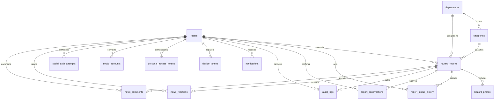

# 03 — Database design and data dictionary

## Database baseline

Production target: MySQL with `utf8mb4`. Schema source: `hazard-server/database/migrations`. SQLite is a portable automated-test substitute; a separate MariaDB database is also used for local MySQL-compatible testing. Do not use test reset commands against a real municipal database.

Notifications and personal access tokens use Laravel's polymorphic owner fields. Notification report identifiers are stored inside JSON data; they are not separate foreign-key columns.

## Business tables

### users

| Field | Type / rule | Meaning |
| --- | --- | --- |
| id | Unsigned bigint primary key | Account identifier |
| name | String | Display name |
| email | String, unique | Login identifier, normalized to lowercase on registration |
| password | String, hidden | Password hash via Laravel's hashed cast |
| role | String, default `citizen` | `citizen` or `admin`; not mass-assignable from registration |
| email_verified_at | Nullable timestamp | Framework field; email verification workflow not implemented |
| remember_token | Nullable, hidden | Framework authentication field |
| created_at / updated_at | Timestamps | Account lifecycle |

### departments and categories

| Table | Fields | Meaning |
| --- | --- | --- |
| departments | `id` string PK; `name` string | Routing departments |
| categories | `id` string PK; `name`; `department_id` FK | Ten hazard categories and default department routing |

Seeded categories: road accident, fallen tree, flooding, fire, road damage, overgrown vegetation, broken streetlight, electrical hazard, waste/obstruction, other hazard. Department names are provisional defaults requiring municipal confirmation.

### hazard_reports

| Field(s) | Type / rule | Meaning |
| --- | --- | --- |
| id | UUID primary key | Internal report identifier |
| reference_number | Unique string | Human-facing `HZ-{year}-{random}` reference |
| user_id | FK users | Reporter; private |
| category_id | FK categories | Hazard classification |
| title | String ≤120 | Short title |
| description | Text; API ≤2000 | Citizen description |
| address | String ≤200 | Street/landmark |
| barangay | String ≤80 | Citizen-entered barangay; not yet a boundary-validated lookup |
| selected_latitude / selected_longitude | Double, required | Citizen hazard pin; latitude −90..90, longitude −180..180 |
| gps_latitude / gps_longitude | Nullable double, paired | Original phone GPS, private |
| gps_accuracy | Nullable double, 0..100000 | Device-reported radius in meters; private |
| location_source | `gps`, `gps_adjusted`, `manual` | Location acquisition method |
| location_difference_meters | Nullable double | Server-computed GPS-to-pin distance |
| verified_latitude / verified_longitude | Nullable paired doubles | Administrator-reviewed coordinates |
| severity | `low`, `moderate`, `high`, `critical` | Current priority |
| status | Valid workflow string | Submitted through closed, or rejected |
| department_id | FK departments | Current responsible department |
| assigned_responder | Nullable string | Team/person name; no responder-account relationship yet |
| verified_at / responded_at / resolved_at | Nullable timestamps | First arrival at each lifecycle milestone |
| created_at / updated_at | Timestamps | Record lifecycle |

Reports also have nullable `deleted_at`. Only the owner can soft-delete a submitted or under-verification report. Soft-deleted reports leave public, personal and news queries; audit and evidence records remain for administrative retention review.

`location_confirmed` is an accepted submission assertion, not a separate stored coordinate or timestamp. The report's original submission time is retained. Private map markers prefer verified coordinates when present; originals remain unchanged. Public coordinates are rounded to two decimal places and must not be used for directions.

### Community content and achievements

| Table | Fields | Meaning |
| --- | --- | --- |
| `municipal_settings` | `key` PK, JSON `value`, timestamps | Admin-managed `map` center/zoom and `hotlines` list. Default hotlines are empty until approved locally. |
| `badges` | ID, unique `threshold`, `name`, `color`, `description`, `reward_type`, nullable `cash_amount`/`reward_description`, timestamps | Fixed milestones: 50 bronze, 100 silver, 1,000 gold, 10,000 platinum. Admins edit display/reward metadata. |
| `news_reactions` | ID, report FK, user FK, `type`, timestamps, unique report/user pair | A citizen has at most one active reaction per confirmed report. |
| `news_comments` | ID, report FK, user FK, `body`, timestamps | Citizen comments with owner/admin deletion. |

Achievement status is calculated from each user's current confirmed-report count rather than stored in a separate award table. This avoids stale awards when a report is rejected or deleted. Reward metadata records a possible municipal benefit; it is not a payout or gift fulfillment ledger.

### Interview-aligned incident fields

Migration `2026_11_08_000001_align_interview_records` adds nullable indexed `occurred_at` (UTC), `injuries` (`unknown` by default; API accepts `yes`/`no`/`unknown`), nullable integer `people_affected` (0?1,000,000, reporter estimate), nullable `public_title` (120 characters) and `public_summary` (API maximum 1,000 characters). Existing reports retain unknown incident time/observations and no public summary; migration never copies private descriptions into public fields. Personal victim names, ages, addresses and diagnoses are not introduced.

### hazard_photos

| Field | Type / rule | Meaning |
| --- | --- | --- |
| id | UUID PK | Photo identifier |
| hazard_report_id | FK, cascade on report deletion | Parent report |
| disk / path | Strings | Local/R2 disk and UUID-based object key |
| original_name | String | Filename received by the API; client compression may have changed it |
| sha256 | 64-character string | Hash of uploaded compressed bytes before server re-encoding |
| bytes | Unsigned integer | Size of the stored WebP |
| photo_type | String, defaults to `incident` | `incident` or `resolution`; independent three-photo limits |
| created_at / updated_at | Timestamps | Upload record times |

The system does not retain the original full-resolution phone image. The stored hash must not be described as a forensic hash of an original camera file. Public JSON returns an empty photo array. Owner/admin JSON returns photo ID, type and an authenticated API media path; disk, original filename, hash and object key remain internal.

### Other application tables

| Table | Core fields and constraints | Purpose |
| --- | --- | --- |
| report_status_history | bigint PK; report FK; actor user FK; status; note; timestamps | Ordered response history |
| report_confirmations | bigint PK; report FK; user FK; unique `(hazard_report_id,user_id)`; timestamps | Idempotent community confirmation |
| audit_logs | bigint PK; actor FK; report FK; action; JSON data; timestamps | Administrative/application traceability |
| notifications | UUID PK; type; polymorphic owner; text JSON data; read_at; timestamps | Reporter inbox |
| device_tokens | bigint PK; user FK; token; unique SHA-256 token_hash; platform; timestamps | FCM recipient registration |
| personal_access_tokens | bigint PK; polymorphic owner; name; unique token hash; abilities; last_used_at; expires_at; timestamps | Sanctum mobile sessions |

### Framework tables

`sessions` supports web login sessions; `password_reset_tokens` is scaffold infrastructure without a password-reset user flow; `cache` and `cache_locks` support configured caching; `jobs`, `job_batches`, and `failed_jobs` support queues; `migrations` records applied schema versions.

## Indexing and integrity

- Unique email, reference number, mobile-token hash, device-token hash and citizen/report confirmation keys prevent duplicate identities and confirmation rows.
- `hazard_reports(status, created_at)` supports status browsing; `(category_id, created_at)` supports duplicate candidates; selected coordinate indexes are provided for future geographic filters.
- Foreign keys preserve report/user/category/department relationships. Application transactions bundle related writes.
- Photo objects are outside MySQL; their storage metadata remains inside the database.
- GPS values are not overwritten during admin verification. API validation restricts ranges and source semantics.
- Database and object-storage backups must correspond to the same restore point. A database backup alone does not contain photographs.

## Social authentication migration

`2026_11_04_000001_add_social_authentication` adds `users.password_enabled` (boolean, default true); the user response exposes computed `has_password`, while hiding the underlying flag and hash. Social-only accounts store a random disabled password hash, preserving the established non-null password schema.

| Table | Fields and invariants |
| --- | --- |
| social_accounts | id; user_id FK/cascade; provider (16); provider_id (255); timestamps. Unique (provider, provider_id) and (user_id, provider). Stores identity only, no provider tokens. |
| social_auth_attempts | UUID id; provider/platform/mode; allowlisted return_origin; intent; code_challenge (43); link_user_id/user_id FKs/null-on-delete; auth_fingerprint (64); access_token_id; exchange_code_hash (64); failures; expires_at index; started_at/completed_at/consumed_at; timestamps. Start lifetime 10 minutes; completed Android code lifetime 90 seconds; row-locked one-use consumption. |

Both tables relate to users. Link proof includes a password/remember-token fingerprint and optional mobile credential ID; it is rechecked at callback. No foreign key is attached to access_token_id so expired/revoked tokens may be pruned and detected as absent. Schedule cleanup removes attempts expired for more than a day. Additive migration preserves existing user/report data; do not reset/reseed a normal database. Schema rollback drops social identities and would strand social-only accounts: plan recovery before any production rollback.
