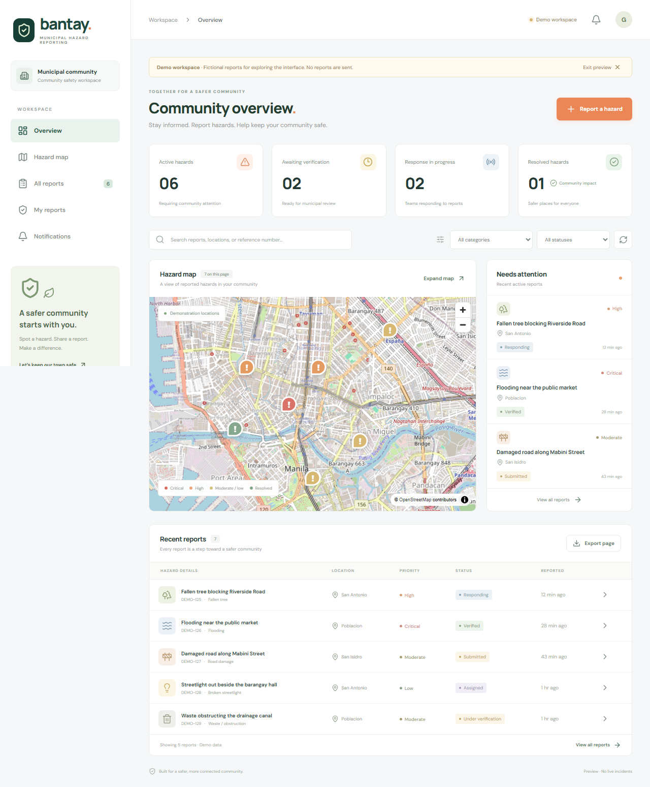
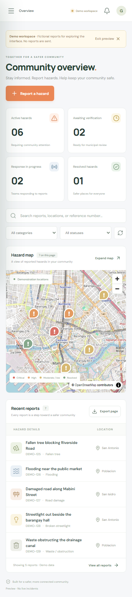

# 05 — Testing and validation

## Latest confirmed-hosting follow-up

The user selected Hostinger Web/Cloud with Android plus responsive web. [The hosting guide](HOSTINGER_WEB_CLOUD.md) records the bounded scheduled worker and relocated public entry; its final verification record supersedes the earlier UI baseline for these changes. Scheduler tests cover bounded batches, overlap, expired-lock recovery, preservation without Firebase and environment-controlled registration.

## Latest UI / stack review

See [4 November 2026 review](UI_STACK_REVIEW_2026-11-04.md) for current PHP 8.5, liquid-glass/responsive UI, comments, push durability, dependency and combined-hosting verification. Earlier records below describe their stated dates and must not override the latest result. No signed Android or real cloud-service result is claimed.

## Mandatory release rule

The user requires **all tests to pass before a GitHub push**. Run parent `npm run verify` on the exact code intended for the push and run each application's own verification command. Each repository has a pre-push hook and CI workflow. Do not bypass the hooks, skip failing tests, or describe incomplete execution as a pass. Any subsequent change invalidates affected results.

The gate covers Composer validation, PHP formatting, Vue type checking, production build, Laravel tests, browser integration, Capacitor synchronization, dependency audits, and documentation consistency. Its local record is `.cache/verification-last.json`. GitHub submission still requires a user request.

## Automated test environment

- Windows development workspace; Node 22.21.0; PHP 8.2.30 with GD/WebP, PDO MySQL and PDO SQLite.
- Laravel 12, Sanctum 4, PHPUnit 11; Vue 3 with Vite and TypeScript; Playwright Chromium.
- SQLite in memory for the default Laravel suite.
- Isolated local MariaDB/MySQL-compatible databases on a separate port for migration/workflow and browser verification. These are not existing municipal databases.
- Browser tests start their own API and Vite processes and shut them down after testing. They use ports 18000 and 15173 by default so normal development servers can stay running. The default browser database is `.cache/e2e.sqlite`; the optional MySQL database is explicitly named `municipal_hazards_e2e`.

## Feature tests

Source: `hazard-server/tests/Feature/HazardWorkflowTest.php`.

| Case | Verified behavior |
| --- | --- |
| Manual submission | Unconfirmed location rejected; valid manual submission persists a compressed photo, history and audit |
| Adjusted GPS | Distant GPS is preserved and flagged while the report remains submitted |
| Source and coordinate validation | Incorrect `gps` labels, missing coordinates and out-of-range values rejected |
| Photo safety | More than three photos, oversized images, invalid content and excessive dimensions rejected |
| Authorization/privacy | Citizens cannot update reports or access another reporter's private evidence; public data excludes private GPS/identity |
| Admin progression | Invalid skipping rejected; full workflow, independent verified coordinates, history, notifications and audits retained |
| Nearby and confirmations | Same-category/radius filtering; unique confirmations; resolved reports cannot be confirmed |
| Account/token controls | Registration cannot assign admin privileges; logout revokes the mobile token |
| Distance calculation | Zero and known-distance cases remain correct |

## Browser tests

Source: `tests/reporting.spec.ts`.

1. Explicit demo dashboard, category filtering, report detail, CSV download, phone viewport, navigation drawer and absence of page-wide horizontal overflow.
2. Real web signup through CSRF/session authentication, client-side photo compression, manual coordinates, explicit confirmation, API submission, photo retrieval, private history, session persistence after reload, own-report list and logout.
3. GPS capture with browser permission, confirmation requirement, pin adjustment, `gps_adjusted` source and invalidation of previous confirmation.

## Current execution record

Executed on **2 October 2026** in the local environment described above:

| Check | Recorded result |
| --- | --- |
| Composer manifest and lockfile | Passed strict validation |
| PHP formatting | Passed |
| Vue TypeScript validation | Passed |
| Production frontend build | Passed |
| Laravel tests, SQLite | 11 passed / 71 assertions |
| Browser tests, isolated SQLite API | 3 passed |
| Laravel tests, isolated MariaDB/MySQL-compatible engine | 11 passed / 71 assertions |
| Browser tests, isolated MariaDB/MySQL-compatible API | 3 passed |
| Capacitor Android synchronization | Passed; not an APK build |
| npm dependency audit | Zero vulnerabilities reported |
| Composer dependency audit | No vulnerability advisories reported |
| Documentation | Local links, 15 requirements, API-route coverage and generated appendix freshness passed |

The two Laravel scaffold smoke tests are included in the 11-test count. The [baseline gate record](evidence/verification-baseline.json) preserves a successful consolidated run. Subsequent evidence/documentation cleanup is verified again with the same gate; `.cache/verification-last.json` is the current local result. Before every push, rerun the full gate on the exact project state. A historical pass does not authorize a later push.

GitHub Actions is configured but has not run remotely because this project has not been pushed. The local compatibility run used MariaDB; the workflow separately specifies MySQL 8.4, whose remote execution remains unobserved.

## Interface evidence

### Local setup regression follow-up

After the split into `hazard-client` and `hazard-server`, the user's local MySQL instance authenticated successfully. `php artisan migrate:status` showed all application migrations as run. The explicit `DemoAccountSeeder` created one administrator and two citizens, and local read-only checks verified each role and distinct password hash. The Laravel suite now passes **14 tests / 83 assertions**, including two seeder cases. No phone APK or real-device result is claimed.

Initially, the local MySQL instance rejected the example's empty password. The correct account password was added to the ignored `.env`, and migrations subsequently completed. `AdminCommandTest` still checks that a pasted Markdown email link is rejected before any database connection. The full release gate must be rerun before a future push.

The following screenshots were captured by the browser test using **fictional, read-only demo records**. They demonstrate interface layout, not real municipal incident collection or field evaluation.





## Reproduction

```sh
npm ci
composer --working-dir=hazard-server install
# Copy hazard-server/.env.example to hazard-server/.env if missing; generate APP_KEY.
php hazard-server/artisan key:generate
npx playwright install chromium
npm run verify
```

For the optional MySQL test run, create dedicated empty `municipal_hazards_test` and `municipal_hazards_e2e` databases. Set `DB_CONNECTION=mysql`, `DB_HOST`, `DB_PORT`, `DB_USERNAME`, `DB_PASSWORD`, and `DB_DATABASE=municipal_hazards_test` for the Laravel suite; set `HAZARD_E2E_MYSQL=1` for browser tests. Never point either at a production database. CI provides an isolated MySQL 8.4 service.

## External validation still required

### Responsive layouts and persistent sessions follow-up

The [follow-up record](RESPONSIVE_SESSIONS_2026-11-03.md) supersedes the earlier
memory-only Android policy and closes the password-change credential-revocation
finding. It documents the responsive changes, 90-day configurable persistent-login
policy and [Android phone testing procedure](ANDROID_TESTING.md). Final executed
results and source hashes are in its linked evidence. Browser device emulation
and a simulated Capacitor secure-storage bridge are separate from physical
Android testing; no APK compilation or real-device acceptance is claimed.

Follow-up final result: **23 Laravel tests / 150 assertions and 16 browser tests
passed**. Production build, type checking, PHP formatting, Android sync and
documentation checks passed. A normal-runtime smoke check also passed. The
release script stops at the nine-vulnerability npm audit; the separately run
Composer audit still fails on `symfony/mime`. Earlier 19/nine counts below remain
historical. See the dated follow-up evidence for source hashes and exact results.

### Runtime and feature review - 3 November 2026

The [current feature audit](FEATURE_AUDIT_2026-11-03.md) records the PHP 8.5/API
rendering repair, moved photo-storage junction, CMS loading repair, feature
inventory and remaining implementation gaps. Historical clean dependency audits
above no longer represent the current state: npm reports nine vulnerabilities
and Composer reports one advisory. The release gate is not currently passing.

The normal running Vue/Laravel application passed a read-only browser smoke check
at 375px with no page errors. Laravel passed 19 tests / 133 assertions on isolated
in-memory SQLite. The production client build and Android asset/plugin sync
passed; no signed APK or physical-device claim is made. New browser coverage
checks malformed/partial API responses and recovery, municipal response through
closure, citizen inbox/mark-read, profile persistence and unverified deletion.

Final combined browser result: **9 tests passed (23.2 seconds)**. `npm run verify`
passed manifest, formatting, type checking, build, 19 Laravel tests, nine browser
tests and Capacitor synchronization, then stopped at the npm audit. Composer
audit separately failed on one advisory; documentation checks separately passed.
The [review evidence](evidence/feature-review-2026-11-03.json) retains these
results and source hashes. No passing release gate, deployment, field validation
or workload acceptance is claimed.


| Area | Evidence required before claiming completion |
| --- | --- |
| Cloudflare R2 | Actual upload, URL retrieval, error handling, deletion/retention, configured access control |
| Firebase web and Android | Real-device permission, token registration, foreground/background receipt, invalid-token cleanup |
| Native Android | Signed APK/AAB, SDK/JDK build log, physical device camera/GPS tests |
| Municipal geography | Approved boundary source, coordinates within/near actual covered barangays |
| Hostinger Web/Cloud | HTTPS, session/cookie behavior, bounded scheduled push, permissions and backup/restore |
| Usability and field accuracy | Approved participant procedure, observed completion time/errors and actual GPS results |
| Capacity and reliability | Defined workload, measured throughput/latency, outage and recovery tests |

Automated simulated GPS is not a measurement of real phone GPS accuracy. A successful database notification is not proof that a push reached a device. Map rendering requires network tiles and compatible WebGL.

## UAT record template

Record: case ID, requirement, software commit, tester role, date, device/OS/browser, network, prerequisites, steps, expected result, actual result, pass/fail, screenshot/log reference, defect ID, retest date, and evaluator approval. Use the cases and blank acceptance form in [Traceability and acceptance](10-traceability-and-acceptance.md). Do not fabricate respondent counts, satisfaction scores, performance percentages or deployment evidence.

## Community-feature verification (2026-10-02)

The isolated Laravel feature suite now checks CMS authorization/validation, confirmed-only news privacy, reactions and comments, badge thresholds, profile password checks, soft deletion, and separation of browsing and registration rate limits. The Playwright suite checks citizen submission and logout confirmations, profile badge visibility, an administrator publishing a hotline through the CMS, and confirmed-news reactions, comments and sharing links. The test runner creates random-password accounts only in its isolated test database. Real emergency numbers, map coordinates, physical-device behavior, and reward fulfillment remain to be validated by the municipality.

## Social authentication follow-up

`SocialAuthenticationTest` uses isolated SQLite and mocked provider identities. It verifies real Google redirect state/PKCE generation and invalid-state rejection, safe creation/repeat identity, collisions, explicit linking, stale proof, HttpOnly remembered sessions, native verifier binding, expiration, replay and five-failure exhaustion. `social-auth.spec.ts` covers both provider buttons, availability, cancellation, return intent, forged return queries and a simulated Android cold launch. Ordinary email/password, reporting and profile regression tests remain required. Browser-runner environments explicitly disable real provider credentials. Real Google/Facebook consent and physical-device/Hostinger acceptance remain pending; see [the setup checklist](SOCIAL_AUTH_SETUP.md).

Social-auth local evidence (4 November): 52 Laravel tests / 390 assertions, 28 browser tests and five launcher tests; the twelve-check parent gate passes. Both npm dependency lockfiles have zero findings; Composer has no advisories and the locked platform requirements pass on PHP 8.5.1. These results use isolated test data/mocked identity providers, including simulated Android cold launch/cancellation. Actual Google/Facebook, physical Android and target hosting acceptance remain pending. See [the dated record](SOCIAL_AUTH_2026-11-04.md).

## Interview and Android alignment ? 8 November 2026

See the [dated review](INTERVIEW_ALIGNMENT_2026-11-08.md) and [evidence record](evidence/interview-alignment-2026-11-08.json). Added API coverage checks private projections and search, owner/admin media access and no-store headers, reviewed publication, incident observation/time validation, resolution-photo limits/cleanup, more-than-one-page PHT period totals and legacy evidence repair. Browser coverage exercises the full lifecycle with distinct resolution evidence, reviewed news, phone reporting with denied-GPS fallback, and phone summary CSV. These are local automated results; no physical Android, actual R2/FCM/OAuth, deployment or municipal UAT is implied.

The new alignment suite additionally passed on isolated MySQL 8.0.44 (eight tests, 85 assertions). A pre-migration test-database guard rejects unapproved schemas. Normal startup/browser/database smoke and simulated 200% text enlargement at 320px passed; OS scaling and physical hardware remain untested. The initial Composer audit failure is preserved in the dated review; five minimal Symfony 7.4.23 patches address the reported findings without a framework migration.

Final local result: **all 12 release checks passed**, including **60 backend tests / 475 assertions, 31 browser tests and five launcher tests**, with zero npm findings and no Composer advisories. The separate MySQL alignment suite passed eight tests / 85 assertions. See [the final gate](evidence/interview-gate-final-2026-11-08.json). This records local verification, not physical Android, live cloud delivery, deployment, workload acceptance or municipal UAT.

## MuniAlert identity, guidance and promotion — 9 November 2026

The branding/guide follow-up passed 61 backend tests / 487 assertions, 36 browser tests and five launcher tests. Coverage includes the unchanged browser-session cookie, guide return after social sign-in, the complete highlighted tour, manual search and phone reflow. A separate normal-runtime guide smoke passed at 320px with simulated 200% text enlargement. Final gate, video lint/audit, MP4 audio/metadata/playback and preview results are recorded in [dated evidence](evidence/branding-guide-promo-2026-11-09.json) and the [handover](BRANDING_GUIDE_PROMO_2026-11-09.md). These results supersede earlier local test counts and retain physical-device/cloud/municipal limitations.

## Basista map follow-up — 9 November 2026

`BasistaScopeTest` covers the 13-name allowlist, ASCII/case normalization, rejection outside the list and the count-preserving conditional camera migration. `maps.spec.ts` uses real MapLibre rendering and the actual local boundary files with deterministic base styles, covering geometry visibility, Fire/accident filtering, synchronized expansion, persisted modes/layers, retry recovery, packaged paths, 320–1440px reflow, simulated 200% text and retained confirmed pins. A separate real-provider review loads Clear/Streets/Dark and attributed labels with synthetic reports. Final results and source hashes are in [the Basista map evidence](evidence/basista-map-2026-11-09.json) and [handover](BASISTA_MAP_2026-11-09.md). Reference boundaries and browser simulation do not establish physical-device or municipal operational acceptance.

## Fresh collaborator download — 9 November 2026

A separate source archive of the published repository was extracted without `.git`, real environments, dependencies, uploaded evidence or compiled builds. Example-based local configuration, a new app key and a new MySQL schema were created; locked npm/Composer installation, platform checks, migrations/seeding and a frontend production build passed. Phone-sized Chromium exercised citizen registration, a synthetic report, confirmed Basista coordinates and authenticated private-photo loading. A separately provisioned administrator signed in and saved a response. No owner database dump or original key/upload folder was needed. The administrator command used scripted prompt answers in the headless harness; interactive terminal password entry and physical USB/Android behavior remain manual checks.

See [the collaborator handover](COLLABORATOR_SETUP_2026-11-09.md) and [evidence](evidence/collaborator-setup-2026-11-09.json). This is a fresh-source test on the existing workstation with prerequisites already installed, not a clean operating-system or physical-device certification.
