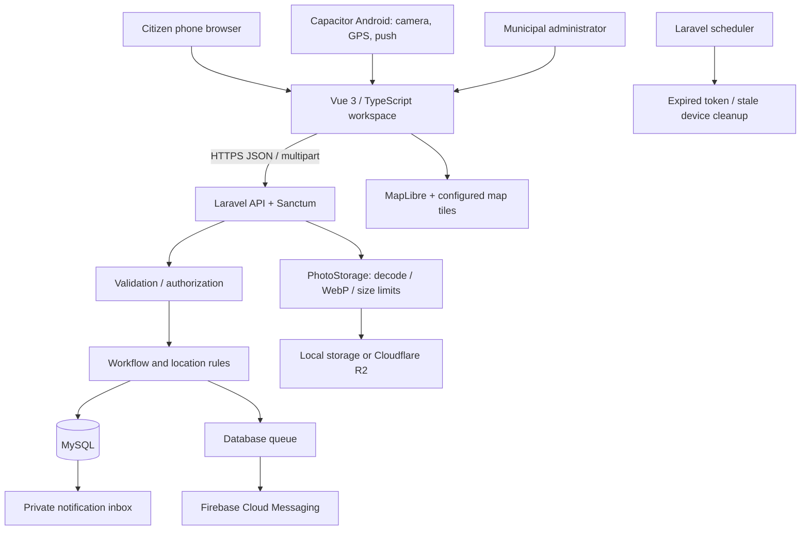
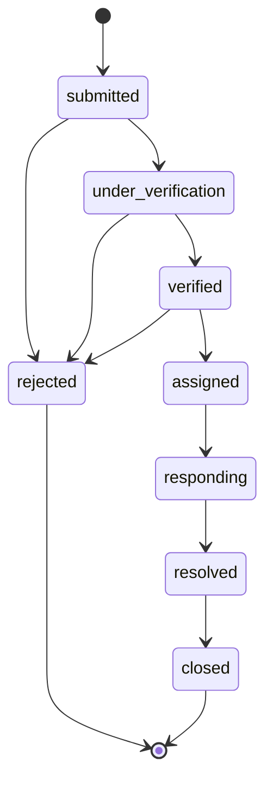
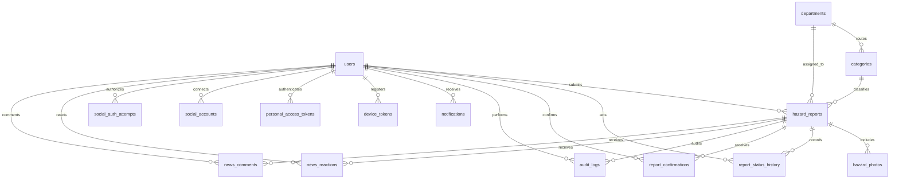

# Municipal Emergency and Public Hazard Reporting System with Photo and Location-Based Incident Tracking

## Capstone technical documentation appendix

Application name: **MuniAlert**. Baseline: 2026-10-02. Institution, proponents and adviser: **to be supplied**. Municipality: **Basista, Pangasinan**.

This appendix documents the implementation and testing evidence. It does not invent field research, cloud deployment or evaluation findings.

<!-- Source SHA256: f249417c4fdefddfdce824dc3877bd5cd4d551ec301c41c07c77d67467b2cba4 -->

# 01 — Project overview and requirements

## Project identity

**Formal title:** Municipal Emergency and Public Hazard Reporting System with Photo and Location-Based Incident Tracking.\
**Application name:** MuniAlert (short for the municipal emergency and public hazard reporting system).\
**Managing office:** Basista Municipal Hall, Pangasinan; the 13 barangays confirmed by the user.\
**Proponents, institution, adviser, and academic year:** to be supplied by the project team.

## Problem statement

The supplied Filipino interview reports an existing phone-based response process that the respondent says has no major reporting problem. Incidents are recorded manually, and the proposed system can improve organized records, completeness, timeliness and weekly/monthly consolidation. Road accidents are a frequent report; rescue, police and RHU coordinate according to need. Victim privacy and simple instructions are explicit requirements. This is qualitative evidence from the supplied document, not a measured response-time failure, respondent-count claim or proof of municipal acceptance. See the [interview and screenshot review](INTERVIEW_ALIGNMENT_2026-11-08.md).

## General objective

Develop and evaluate a mobile-friendly system through which citizens submit photographed, geographically identified hazards and municipal administrators verify, assign, respond to, and close those reports.

## Specific objectives

1. Provide a citizen workflow for a hazard category, description, photo evidence, barangay, and landmark.
2. Support device GPS and manually placed or adjusted pins, requiring explicit location confirmation.
3. Preserve GPS coordinates/accuracy and the selected pin independently, and display their distance for administrator review.
4. Provide a map-centered dashboard, filtering, status history, department routing, and responder assignment.
5. Reduce duplicate dispatches by suggesting recent, same-category reports within 100 meters and recording citizen confirmations.
6. Reduce storage and bandwidth through photo compression and configurable object storage.
7. Notify reporters of status changes through an in-app inbox and configured push integrations.
8. Verify the implementation using automated tests and subsequently evaluate it with actual municipal users.

## Stakeholders and roles

| Actor | Responsibilities |
| --- | --- |
| Guest | Browse public hazards and view community statistics; sign in to report |
| Citizen | Submit reports, confirm another active hazard, track own private history, read notifications |
| Municipal administrator | Verify evidence/location, set priority, select department/team, post response notes, resolve and close reports |
| Student maintainer | Maintain code, tests, documentation, deployment configuration, backups and supported dependencies |
| Municipal operator/adviser | Approve operational workflow, public information policy, acceptance criteria and study procedures |

Responder assignment is a team/name field in this version. A separately authenticated responder app and dispatch roster are not implemented.

## Functional requirements

| ID | Requirement | Acceptance criterion |
| --- | --- | --- |
| FR-01 | Separate web and API applications | Vue frontend and Laravel backend build/run independently |
| FR-02 | Authentication and role enforcement | Public registration creates only citizens; admin operations reject citizens; remembered sessions survive browser/app restarts and logout revokes access |
| FR-03 | Photo reporting | At least one and at most three valid photos; final images at most 1 MB and 1920 pixels per side |
| FR-04 | GPS capture | GPS latitude, longitude and accuracy stored as a complete group |
| FR-05 | Manual/adjusted location | A manually selected pin is valid without GPS; adjusted GPS remains separate |
| FR-06 | Location confirmation | Submitting without explicit confirmation fails; editing a pin resets confirmation |
| FR-07 | Location verification | Admin sees source, distance and accuracy, and stores independent verified coordinates |
| FR-08 | Map and discovery | Hazards appear as map markers and searchable/filterable paginated records |
| FR-09 | Duplicate detection | Suggest active same-category hazards within 100 m and six hours |
| FR-10 | Confirmations | One confirmation per citizen/report; reporters cannot confirm their own report |
| FR-11 | Workflow and routing | Valid transitions only; assigned status requires a response team; defaults route by category |
| FR-12 | Traceability | Status notes, actor references, timestamps and audit entries are retained |
| FR-13 | Notifications | Status updates create a private inbox entry; configured FCM job delivers push |
| FR-14 | Android integration | Capacitor project contains camera, geolocation and push integrations |
| FR-15 | Documentation and release verification | Phase tracker and capstone attachments maintained; all required checks pass before any GitHub push |
| FR-16 | Private evidence and reviewed publication | Raw descriptions, exact locations, observations and photos are owner/admin only; public news requires a separate admin-reviewed title/summary |
| FR-17 | Incident observations | Optional incident time and affected-person estimate; explicit yes/no/unknown injury observation; no victim identity fields |
| FR-18 | Resolution evidence | Administrators may add up to three private resolution photos, separately typed from the three incident photos |
| FR-19 | Period consolidation | Admin can filter up to 366 days and export weekly/monthly report counts with PHT dates and unknown-time fallback disclosed |
| FR-20 | Consistent application identity | MuniAlert is displayed in the web interface and Android label; the full user-approved capstone title appears in the guide and current documents |
| FR-21 | Feature guidance and user manual | Guests, citizens and admins can browse role-specific instructions, search topics and run a six-step highlighted tour |
| FR-22 | Promotional deliverables | Remotion source and editable preview plus user-requested MP4 exports use clearly labeled synthetic demonstrations |
| FR-23 | Clear, configurable map | Clear/Streets/Dark styles, independently switchable boundary levels, fit/area controls and synchronized hazard-category filtering remain usable on phones |
| FR-24 | Basista service area | Basista Municipal Hall covers exactly the 13 user-selected barangays; report entry uses an allowlist and map assets carry source provenance |

## Nonfunctional requirements

| ID | Requirement | Verification approach |
| --- | --- | --- |
| NFR-01 | Responsive access | Browser checks from 320px to 1920px, including tablet and landscape, with responsive report cards and no page-wide horizontal overflow |
| NFR-02 | Privacy and authorization | Public responses omit raw descriptions, precise coordinates, injury observations, original photos, identity and GPS; direct unauthorized media requests fail |
| NFR-03 | Data integrity | Foreign keys, unique confirmations, transactional history/notifications/audits, guarded status transitions |
| NFR-04 | Maintainability | Separate services/composables/configuration, migrations, reproducible lockfiles and documented commands |
| NFR-05 | Honest failure feedback | Unavailable server, denied GPS, image failure and unconfigured push show understandable messages |
| NFR-06 | Low operating dependency | Local development storage works; R2, map provider and Firebase are configurable |
| NFR-07 | Deployment safety | HTTPS, private environment files, least-privilege DB credentials and worker/scheduler supervision |

Performance targets, availability SLA, recovery time, retention period and usability thresholds must be approved before evaluation. No numerical performance achievement is claimed without a measured test.

## Scope and limitations

Implemented: citizen/admin workflows, photo compression, GPS/manual pins, evidence comparison, map/list dashboard, basic routing, status history, confirmations, in-app notifications, integration code, and technical documentation.

Not yet externally validated: real R2 access, FCM delivery, signed APK/AAB, actual barangay boundaries, Hostinger deployment, device field performance, backup restoration on the target host, and municipal UAT.

Outside this version: offline submission/synchronization, native iOS packaging, continuous location tracking, emergency dispatch guarantees, AI hazard classification, real-time responder tracking, verified identity enrollment, heatmaps, advanced analytics, and an administrative account-management UI. A report is not an emergency call.

## Social authentication extension ? 4 November 2026

FR-02 now includes Google and Facebook signup/sign-in through Laravel Socialite for responsive web and Android. Password accounts can explicitly connect a provider after confirming their password. New social accounts are citizens; matching email never silently links identities. Provider configuration, real consent/callback tests, physical Android and target-host acceptance remain external requirements. See [provider setup](SOCIAL_AUTH_SETUP.md).


---

# 02 — System architecture and source structure

## Accepted technology baseline

The user selected one private `Ajhon10/MuniAlert` GitHub workspace repository on 9 November 2026 for team testing. The Vue client and Laravel server remain separate applications in `hazard-client/` and `hazard-server/`; shared tests, capstone documentation and deployment examples live at the root. Earlier local Git histories are preserved in ignored backups. This repository consolidation does not change the accepted stack or hosting architecture. Web releases package Vue inside Laravel’s public directory for one-origin Hostinger deployment. The confirmed deployment target is Hostinger Web/Cloud hosting, with Android plus responsive web as clients. See [the selected hosting guide](HOSTINGER_WEB_CLOUD.md), [stack review](STACK_AND_HOSTINGER.md) and [team setup](TEAM_TESTING.md).

Vue 3 + TypeScript + Vite provides the client application. Capacitor packages the same client for Android. Laravel 12 exposes the REST API, Sanctum authenticates requests, and MySQL persists application data. MapLibre renders the map; a configurable tile/style provider supplies cartography. Laravel Filesystem stores evidence on a private local evidence disk or an operator-verified private Cloudflare R2 bucket. Authenticated media requests authorize each report/photo; original files are never published by the UI. Database notifications work independently of Firebase; a queued job can send FCM HTTP v1 messages when configured.

The client now presents role-specific navigation: citizens see reporting, verified news, notifications and their profile; administrators see report review, content management and their profile. The API independently checks roles for every privileged mutation. A public settings endpoint supplies approved hotlines and the initial map center. Confirmed-report news requires both a confirmed status and a separately reviewed public title/summary; citizen comments and reactions are stored separately. Achievement badges are calculated from verified report counts and their definitions are managed by administrators. The Philippine clock is formatted in the browser with the `Asia/Manila` time zone and updates every second.




## Repository structure

```text
BANTAY/
├── hazard-client/
│   ├── src/
│   │   ├── views/DashboardView.vue      # Workspace composition
│   │   ├── components/                # Map, report form, auth, detail, dialog
│   │   ├── composables/useDashboard.ts # Workspace state and actions
│   │   ├── services/                  # HTTP, media/GPS, push integrations
│   │   ├── config/api.ts              # Configured API server origin
│   │   ├── types/index.ts             # Typed API/domain contracts
│   │   ├── data/demo.ts               # Explicit fictional preview fixtures
│   │   └── assets/main.css            # Responsive UI styles
│   ├── android/                      # Capacitor native project
│   └── capacitor.config.ts
├── hazard-server/
│   ├── app/Http/Controllers/Api/      # HTTP orchestration
│   ├── app/Http/Requests/             # Input validation
│   ├── app/Http/Resources/            # Public/private JSON projection
│   ├── app/Models/                    # Eloquent entities and relations
│   ├── app/Services/PhotoStorage.php  # Image processing/storage boundary
│   ├── app/Support/                   # Location mathematics, status rules
│   ├── app/Jobs/SendReportPush.php    # Queued FCM delivery
│   ├── app/Console/Commands/          # Administrator provisioning
│   ├── database/migrations/          # Canonical schema
│   ├── database/seeders/             # Categories/departments only
│   ├── routes/                       # API, web auth, scheduler registration
│   └── tests/Feature/                 # Isolated workflow/security tests
├── deployment/                       # Nginx, worker and environment guidance
├── documentation/                    # Capstone and operational attachments
├── scripts/                          # Verification, test server, docs build
├── tests/                            # Playwright browser tests
├── hazard-client/.github/workflows/  # Client verification
├── hazard-server/.github/workflows/  # Server verification
├── AGENTS.md / MEMORY.md / TASKS.md
└── package.json
```

## Principles adapted from PDEA

The reference was read from the existing local `PDEA/pdea-server` and `PDEA/pdea-client` source, including `composer.json`, `routes/api.php`, `app/Services/FileStorageService.php`, `tests/Feature/SecurityHardeningTest.php`, `src/config/api.ts`, `src/services/authService.ts`, and the frontend `views`, `layout`, and `composables` directories. PDEA's historical architecture HTML labels itself historical, so current source took precedence.

| Reference principle | Application in Bantay |
| --- | --- |
| Separate Vue client and Laravel server | Independent `hazard-client/` and `hazard-server/` roots |
| API controller namespace | `Http/Controllers/Api` with Sanctum-protected routes |
| Storage isolated behind service/config | Active `PhotoStorage` and configured local/R2 disk |
| Shared frontend API configuration and services | `config/api.ts`, `services/api.ts`, device integration services |
| Reusable frontend logic and components | `composables/useDashboard.ts`, components, workspace view |
| Role checks and security feature tests | Owner/admin privacy, role enforcement, token and workflow tests |
| Migrations and operational handover | Versioned schema, deployment guide, task/release records |

PDEA's domain-specific museum modules, data, credentials, DigitalOcean settings, legacy bootstrap layout, and historical deployment details were not copied. Bantay uses the Laravel 12 application skeleton and its accepted R2/MySQL design. The single workspace uses local view state rather than PDEA's larger multi-page router structure.

## Report submission sequence

```mermaid
sequenceDiagram
    actor C as Citizen
    participant V as Vue / Capacitor
    participant A as Laravel API
    participant S as Photo storage
    participant D as MySQL
    C->>V: Add category, photos and description
    V->>V: Compress photo; get GPS or manual pin
    C->>V: Confirm selected location
    V->>A: Look for same-category nearby reports
    A->>D: Active reports within six-hour/latitude filter
    A-->>V: Candidates within 100 meters
    C->>V: Confirm duplicate or submit new report
    V->>A: Authenticated multipart submission
    A->>A: Validate fields, GPS source, confirmation, files
    A->>S: Re-encode and store WebP photos
    A->>D: Transaction: report, photo metadata, history, audit
    A-->>V: Reference number and submitted status
```

If persistence fails after photos are stored, the application attempts to delete those newly stored objects. Operational monitoring should check for orphaned objects if a storage provider is unavailable during cleanup.

## Interview-aligned records and privacy ? 8 November 2026

Android phones are the primary client; responsive web remains supported. The existing custom Vue UI is retained; Vuetify is not installed or required. The Filipino interview supports private evidence, simple instructions, safe emergency calling and periodic incident records. See the [source-by-source review](INTERVIEW_ALIGNMENT_2026-11-08.md).

Raw titles/descriptions, exact addresses/coordinates, incident observations, evidence and response history are restricted to the reporter and authorized administrators. Public lists show generic or reviewed titles, separate reviewed summaries, barangay and coordinates rounded to two decimals. Public search does not search private title/address fields. Public news requires explicit summary publication even after verification. Evidence is fetched with the existing cookie or Android bearer credential and displayed through temporary blob URLs; no token is embedded in an image URL.

`EvidenceController` validates and saves up to three resolution photos separately from incident evidence, locks the report before checking status/count, and records an audit. `AnalyticsController` aggregates all matching records in SQL by PHT day, then regroups at most 366 daily rows into weeks/months. Incident time is used when supplied; otherwise submission time is explicitly identified as a fallback. Summaries count reports, including unverified ones, and exclude rejected/deleted records. They do not establish unique incidents, injuries or causes.

## State model



An administrator may add notes or adjust nonterminal records without changing the current status. Closed and rejected reports are terminal. Verification requires verified coordinates; assignment requires a responder/team. Updates lock the database row, validate the transition, and write history, audit and the citizen notification transactionally. When FCM is configured, one database job per registered device is inserted on the same database before commit. Report changes, history, audit, inbox and queue insertion therefore commit or roll back together. The report-push worker retries each device independently; delivery remains at least once across a provider-accepted/worker-crash boundary.

## Location model

`gps_latitude`, `gps_longitude`, and `gps_accuracy` describe one requested device reading. `selected_latitude`/`selected_longitude` describe the citizen's hazard pin. `verified_latitude`/`verified_longitude` describe the administrator's review. These are not continuous device tracking.

`location_source` is `gps`, `gps_adjusted`, or `manual`. The server rejects a `gps` label when the pin differs from GPS beyond a one-millionth-degree tolerance. A GPS-to-pin distance above 250 meters or reported GPS accuracy worse than 100 meters prompts review. These configurable heuristics do not prove accuracy, fraud, or invalidity.

The Haversine formula calculates approximate distance in meters. A latitude-band/category/time query reduces nearby candidates before distance filtering. There is no PostGIS dependency and no claim of survey-grade precision.

## Authentication boundaries

Web clients obtain Laravel's CSRF cookie and use persistent HttpOnly session/remember cookies. The default web session inactivity window is 90 days (129600 minutes). Native Android clients persist a Sanctum token with Capacitor secure-storage 7.1.3 and Android Keystore; authenticated use renews its configurable 90-day expiry at most hourly. Expired/revoked tokens are rejected before renewal. Logout clears/revokes the device credential. Password changes revoke other mobile tokens and rotate remember credentials; Sanctum rejects browser sessions containing the old password hash. The current device remains signed in. Login and password changes lock the user row to serialize credential issuance with password changes. Public registration cannot set an administrator role. Private history and original GPS are limited to the reporter and administrators. This follows the separation described in [Laravel Sanctum's SPA and mobile authentication documentation](https://laravel.com/docs/12.x/sanctum).

## Scheduled push on the selected hosting plan

With `HAZARD_SCHEDULED_PUSH=true`, the hPanel scheduler cron runs a CLI-only `hazard:work-push` batch every permitted minute. A database lock prevents overlapping scheduled workers; each batch exits after three jobs or a 30-second between-job budget. Jobs remain durable in the same application database. The 180-second worker lock recovers after a killed process; reserved jobs can retry after 90 seconds. Missing Firebase configuration preserves pending jobs. OAuth requests are bounded independently of optional PHP signal timeouts. This mode needs no persistent daemon. In-app inbox persistence remains independent of delayed FCM delivery. The real account's limits and accepted latency must still be measured.

## Google and Facebook authentication

Laravel Socialite performs provider redirects and code exchange; server-only credentials live in services configuration. Web returns to an allowlisted origin and uses Sanctum-compatible HttpOnly session/remember cookies. Android uses Capacitor App/Browser plugins, an external browser, a fixed custom-scheme callback and a 90-second one-use code protected by an S256 verifier held in native secure storage. No provider access/refresh token or Sanctum token is placed in client redirect URLs. Google also uses PKCE on the server-to-provider authorization flow. Accounts link only through explicit password confirmation and authenticated identity proof. This adds no permanent worker requirement to Hostinger Web/Cloud. See [setup and acceptance](SOCIAL_AUTH_SETUP.md).

## MuniAlert identity, local guidance and promotional authoring

The user approved the full capstone title: **Municipal Emergency and Public Hazard Reporting System with Photo and Location-Based Incident Tracking**. The selected short application name is **MuniAlert**, with subtitle **Emergency & Public Hazard Reporting**. Display names and current documentation are updated; stable Android package/auth identifiers stay compatible with existing installations and callbacks. Client identity lives in `src/config/identity.json`.

The default browser-session cookie remains `bantay_session`, independently of `APP_NAME`, so a display-name change preserves existing browser sessions. An explicitly configured `SESSION_COOKIE` is still respected. Native package ID, deep-link callback and secure-storage keys also retain their established values.

`?view=guide` loads a bundled static, searchable citizen/admin manual. It needs no new API, database, account privilege or external service. The six-step `FeatureTour` uses a native dialog, highlights real overview controls, supports back/next/skip/ESC, and can be replayed. Instructions describe only implemented behavior; public reading of administrator instructions grants no administrative access. Browser print support produces an expanded manual.

The requested Remotion video is a separate **React + TypeScript** authoring artifact under `promo-video/`, with its own lockfile and local Studio. This stack is explicitly supplied by the user through the Remotion request; it does not migrate the Vue application. The video has no backend/database/hosting requirement. The user explicitly requested **MP4 plus editable preview**. Use synthetic demonstration screens and locally generated narration/music, with no credentials or real incident evidence in public video assets. Local source, rendered media, deployment and physical-device acceptance remain distinct.

At the user's request, narration now matches KIKOS Order Planner's generic Kokoro `af_heart` preset and q8 model. The separate video project carries the pinned speech tools and generated WAVs; large model files stay in an ignored local cache and are unnecessary for preview/rendering. The source gate verifies voice/clip hashes and scene timing. See [narration reproduction](../promo-video/NARRATION.md).

## Basista map and service area — 9 November 2026

The user confirmed **Basista Municipal Hall, Pangasinan**, covering Anambongan, Bayoyong, Cabeldatan, Dumpay, Malimpec East, Mapolopolo, Nalneran, Navatat, Obong, Osmeña Sr., Palma, Patacbo and Poblacion. Client `config/municipality.json` and server `config/municipality.php` define the same 13 names, verified by the integration documentation check. New reports use this allowlist; case/ASCII variants normalize to the canonical spelling. Existing incident records are preserved. Reference geometry is not a legal geofence: the form warns about pins outside the reference extent but does not infer legal jurisdiction or overwrite GPS.

The existing MapLibre renderer now offers Clear (OpenFreeMap Positron), Streets (OpenStreetMap raster), Dark (OpenFreeMap Dark), and an optional configured municipal style. Preferences store only display mode and boundary booleans in guarded browser storage. Changing style retains the map camera, report markers, selected incident pin and original GPS; `style.load` reinstalls enabled boundary layers. Quiet report refreshes with unchanged locations retain the camera. The map's category selector shares the dashboard filter/query, and overview/map expansion preserves filters. Map pagination explicitly covers report pages rather than implying all database records are loaded.

Bundled GeoJSON provides 13 detailed Basista barangays, six nearby city/municipality outlines and Pangasinan province context (approximately 102 KB total uncompressed). These public geographic assets are separate from private incident evidence. Names appear as zoom-dependent labels; overlays have separate switches, colors and line styles. The worker requests local files only when enabled, while basemap tiles/fonts still need network access. `VITE_BARANGAY_GEOJSON_URL`, `VITE_CITY_GEOJSON_URL` and `VITE_PROVINCE_GEOJSON_URL` can replace the reference files with approved data. See [map source and acceptance notes](BASISTA_MAP_2026-11-09.md).

The camera migration changes only the former generic Manila center to Basista; it retains customized camera settings and never edits users or reports. This is source implementation and local verification, not field boundary acceptance or Android hardware certification.

## Compact header and team publication — 9 November 2026

Compact widths (up to 1023 CSS pixels) use bottom **More** as their navigation entry; the redundant header menu is removed. The header shows the app name, guide action, connection indicator and account. Clock/page context remains in the content heading. Desktop utilities share the page-heading row, with no dedicated blank toolbar row. A shared `WorkspaceHeader` renders in the appropriate location when the breakpoint changes. The header uses a solid reading surface so scrolling manual text does not bleed through the decorative material. Keyboard drawer dismissal restores focus to More.

The compact header attaches to the viewport's top edge with no forced margin or sticky breathing offset. Real device safe-area padding is inside the header surface, rather than an empty band above it. Desktop heading placement is unchanged by this compact-only rule.

Native modal dialogs use three flex regions: a fixed header, one keyboard-focusable scrolling body and a fixed named footer slot. Authentication and report components own their modal so their reactive actions can populate that footer directly. Footer submit buttons associate with uniquely identified forms, preserving browser validation and Enter submission. Nested confirmations share a reference-counted body-scroll lock. The outer dialog clips overflow to prevent photo/focus changes from scrolling its chrome. The feature-tour sheet uses the same header/body/footer pattern. The viewport requests content resizing for Android's onscreen keyboard; real-device behavior remains an acceptance check.

The root pre-push hook runs the complete gate and rejects an uncommitted publication state. CI checks the same workspace using PHP 8.5 and Node 22, including source-publication safety and the separate Remotion lint/audit. A manual Android debug-APK workflow accepts only a public HTTPS API origin without credentials. GitHub source access does not host the API or establish physical-device acceptance. The fraud guide separates existing verification/rate-limit controls from proposed contact verification and account moderation; no automatic fraud classifier was introduced.


---

# 03 — Database design and data dictionary

## Database baseline

Production target: MySQL with `utf8mb4`. Schema source: `hazard-server/database/migrations`. SQLite is a portable automated-test substitute; a separate MariaDB database is also used for local MySQL-compatible testing. Do not use test reset commands against a real municipal database.



Notifications and personal access tokens use Laravel's polymorphic owner fields. Notification report identifiers are stored inside JSON data; they are not separate foreign-key columns.

## Business tables

### users

| Field | Type / rule | Meaning |
| --- | --- | --- |
| id | Unsigned bigint primary key | Account identifier |
| name | String | Display name |
| email | String, unique | Login identifier, normalized to lowercase on registration |
| password | String, hidden | Password hash via Laravel's hashed cast |
| role | String, default `citizen` | `citizen` or `admin`; not mass-assignable from registration |
| email_verified_at | Nullable timestamp | Framework field; email verification workflow not implemented |
| remember_token | Nullable, hidden | Framework authentication field |
| created_at / updated_at | Timestamps | Account lifecycle |

### departments and categories

| Table | Fields | Meaning |
| --- | --- | --- |
| departments | `id` string PK; `name` string | Routing departments |
| categories | `id` string PK; `name`; `department_id` FK | Ten hazard categories and default department routing |

Seeded categories: road accident, fallen tree, flooding, fire, road damage, overgrown vegetation, broken streetlight, electrical hazard, waste/obstruction, other hazard. Department names are provisional defaults requiring municipal confirmation.

### hazard_reports

| Field(s) | Type / rule | Meaning |
| --- | --- | --- |
| id | UUID primary key | Internal report identifier |
| reference_number | Unique string | Human-facing `HZ-{year}-{random}` reference |
| user_id | FK users | Reporter; private |
| category_id | FK categories | Hazard classification |
| title | String ≤120 | Short title |
| description | Text; API ≤2000 | Citizen description |
| address | String ≤200 | Street/landmark |
| barangay | String ≤80 | Citizen-entered barangay; not yet a boundary-validated lookup |
| selected_latitude / selected_longitude | Double, required | Citizen hazard pin; latitude −90..90, longitude −180..180 |
| gps_latitude / gps_longitude | Nullable double, paired | Original phone GPS, private |
| gps_accuracy | Nullable double, 0..100000 | Device-reported radius in meters; private |
| location_source | `gps`, `gps_adjusted`, `manual` | Location acquisition method |
| location_difference_meters | Nullable double | Server-computed GPS-to-pin distance |
| verified_latitude / verified_longitude | Nullable paired doubles | Administrator-reviewed coordinates |
| severity | `low`, `moderate`, `high`, `critical` | Current priority |
| status | Valid workflow string | Submitted through closed, or rejected |
| department_id | FK departments | Current responsible department |
| assigned_responder | Nullable string | Team/person name; no responder-account relationship yet |
| verified_at / responded_at / resolved_at | Nullable timestamps | First arrival at each lifecycle milestone |
| created_at / updated_at | Timestamps | Record lifecycle |

Reports also have nullable `deleted_at`. Only the owner can soft-delete a submitted or under-verification report. Soft-deleted reports leave public, personal and news queries; audit and evidence records remain for administrative retention review.

`location_confirmed` is an accepted submission assertion, not a separate stored coordinate or timestamp. The report's original submission time is retained. Private map markers prefer verified coordinates when present; originals remain unchanged. Public coordinates are rounded to two decimal places and must not be used for directions.

### Community content and achievements

| Table | Fields | Meaning |
| --- | --- | --- |
| `municipal_settings` | `key` PK, JSON `value`, timestamps | Admin-managed `map` center/zoom and `hotlines` list. Default hotlines are empty until approved locally. |
| `badges` | ID, unique `threshold`, `name`, `color`, `description`, `reward_type`, nullable `cash_amount`/`reward_description`, timestamps | Fixed milestones: 50 bronze, 100 silver, 1,000 gold, 10,000 platinum. Admins edit display/reward metadata. |
| `news_reactions` | ID, report FK, user FK, `type`, timestamps, unique report/user pair | A citizen has at most one active reaction per confirmed report. |
| `news_comments` | ID, report FK, user FK, `body`, timestamps | Citizen comments with owner/admin deletion. |

Achievement status is calculated from each user's current confirmed-report count rather than stored in a separate award table. This avoids stale awards when a report is rejected or deleted. Reward metadata records a possible municipal benefit; it is not a payout or gift fulfillment ledger.

### Interview-aligned incident fields

Migration `2026_11_08_000001_align_interview_records` adds nullable indexed `occurred_at` (UTC), `injuries` (`unknown` by default; API accepts `yes`/`no`/`unknown`), nullable integer `people_affected` (0?1,000,000, reporter estimate), nullable `public_title` (120 characters) and `public_summary` (API maximum 1,000 characters). Existing reports retain unknown incident time/observations and no public summary; migration never copies private descriptions into public fields. Personal victim names, ages, addresses and diagnoses are not introduced.

### hazard_photos

| Field | Type / rule | Meaning |
| --- | --- | --- |
| id | UUID PK | Photo identifier |
| hazard_report_id | FK, cascade on report deletion | Parent report |
| disk / path | Strings | Local/R2 disk and UUID-based object key |
| original_name | String | Filename received by the API; client compression may have changed it |
| sha256 | 64-character string | Hash of uploaded compressed bytes before server re-encoding |
| bytes | Unsigned integer | Size of the stored WebP |
| photo_type | String, defaults to `incident` | `incident` or `resolution`; independent three-photo limits |
| created_at / updated_at | Timestamps | Upload record times |

The system does not retain the original full-resolution phone image. The stored hash must not be described as a forensic hash of an original camera file. Public JSON returns an empty photo array. Owner/admin JSON returns photo ID, type and an authenticated API media path; disk, original filename, hash and object key remain internal.

### Other application tables

| Table | Core fields and constraints | Purpose |
| --- | --- | --- |
| report_status_history | bigint PK; report FK; actor user FK; status; note; timestamps | Ordered response history |
| report_confirmations | bigint PK; report FK; user FK; unique `(hazard_report_id,user_id)`; timestamps | Idempotent community confirmation |
| audit_logs | bigint PK; actor FK; report FK; action; JSON data; timestamps | Administrative/application traceability |
| notifications | UUID PK; type; polymorphic owner; text JSON data; read_at; timestamps | Reporter inbox |
| device_tokens | bigint PK; user FK; token; unique SHA-256 token_hash; platform; timestamps | FCM recipient registration |
| personal_access_tokens | bigint PK; polymorphic owner; name; unique token hash; abilities; last_used_at; expires_at; timestamps | Sanctum mobile sessions |

### Framework tables

`sessions` supports web login sessions; `password_reset_tokens` is scaffold infrastructure without a password-reset user flow; `cache` and `cache_locks` support configured caching; `jobs`, `job_batches`, and `failed_jobs` support queues; `migrations` records applied schema versions.

## Indexing and integrity

- Unique email, reference number, mobile-token hash, device-token hash and citizen/report confirmation keys prevent duplicate identities and confirmation rows.
- `hazard_reports(status, created_at)` supports status browsing; `(category_id, created_at)` supports duplicate candidates; selected coordinate indexes are provided for future geographic filters.
- Foreign keys preserve report/user/category/department relationships. Application transactions bundle related writes.
- Photo objects are outside MySQL; their storage metadata remains inside the database.
- GPS values are not overwritten during admin verification. API validation restricts ranges and source semantics.
- Database and object-storage backups must correspond to the same restore point. A database backup alone does not contain photographs.

## Social authentication migration

`2026_11_04_000001_add_social_authentication` adds `users.password_enabled` (boolean, default true); the user response exposes computed `has_password`, while hiding the underlying flag and hash. Social-only accounts store a random disabled password hash, preserving the established non-null password schema.

| Table | Fields and invariants |
| --- | --- |
| social_accounts | id; user_id FK/cascade; provider (16); provider_id (255); timestamps. Unique (provider, provider_id) and (user_id, provider). Stores identity only, no provider tokens. |
| social_auth_attempts | UUID id; provider/platform/mode; allowlisted return_origin; intent; code_challenge (43); link_user_id/user_id FKs/null-on-delete; auth_fingerprint (64); access_token_id; exchange_code_hash (64); failures; expires_at index; started_at/completed_at/consumed_at; timestamps. Start lifetime 10 minutes; completed Android code lifetime 90 seconds; row-locked one-use consumption. |

Both tables relate to users. Link proof includes a password/remember-token fingerprint and optional mobile credential ID; it is rechecked at callback. No foreign key is attached to access_token_id so expired/revoked tokens may be pruned and detected as absent. Schedule cleanup removes attempts expired for more than a day. Additive migration preserves existing user/report data; do not reset/reseed a normal database. Schema rollback drops social identities and would strand social-only accounts: plan recovery before any production rollback.


---

# 04 — REST API reference

## Conventions and authentication

Development API origin: `http://localhost:8000`. Vite proxies `/api`, `/auth`, `/sanctum`, and `/storage`. Production should use one HTTPS origin for the frontend and Laravel routes. Set `VITE_API_BASE_URL` to the HTTPS server origin for Android; it must not include a trailing `/api`.

Send `Accept: application/json`. JSON mutations use `Content-Type: application/json`; uploads use multipart form data with repeated `photos[]` parts. Single-report responses use `{ "data": { ... } }`. Lists use Laravel's `data`, `links`, and `meta` pagination envelope, with 100 reports per page.

For web authentication: `GET /sanctum/csrf-cookie`, then `POST /auth/register` or `/auth/login`, sending the decoded `XSRF-TOKEN` cookie as `X-XSRF-TOKEN` and including cookies. For Android: `POST /api/auth/register` or `/api/auth/login` returns a Sanctum token. Send it as `Authorization: Bearer <token>`. Tokens expire after 90 days without authenticated use by default (AUTH_SESSION_DAYS); middleware renews valid mobile tokens at most hourly. They are revoked at logout and removed from secure native storage. Web sign-in issues an HttpOnly remember cookie and a persistent session cookie; SESSION_LIFETIME defaults to 129600 minutes and SESSION_EXPIRE_ON_CLOSE=false. Clearing site/app data, revocation or prolonged inactivity requires sign-in again.

The health endpoint returns `{ "status": "ok" }` after a successful database query, or HTTP 503 with `{ "status": "unavailable" }` when that query fails. It does not return database error details. Local development adds a hashed workspace identity header for safe launcher reuse; production omits it.

## Endpoint inventory

| Method | Path | Access | Purpose |
| --- | --- | --- | --- |
| GET | `/api/health` | Public | Database-backed API health check |
| GET | `/api/catalog` | Public | Categories and departments |
| GET | `/api/stats` | Public | Total, active, pending, responding, resolved counts |
| GET | `/api/admin/analytics` | Administrator | Bounded weekly/monthly record totals by PHT date and optional category |
| GET | `/api/reports/{report}/photos/{photo}` | Owner/admin | Authorized WebP bytes; private/no-store; scoped photo ID |
| POST | `/api/reports/{report}/resolution-photos` | Administrator | One to three private resolution uploads; three total per report |
| GET | `/api/reports` | Public | Report list; rejected reports excluded |
| GET | `/api/reports/nearby` | Public | Recent duplicate candidates |
| GET | `/api/settings` | Public | Municipal map center/zoom and emergency hotlines |
| GET | `/api/badges` | Public | Badge definitions and reward descriptions |
| GET | `/api/news` | Public | Confirmed-report news, 20 per page; optional `report` UUID |
| GET | `/api/news/{report}/comments` | Public | 25 comments per page; optional nonnegative `after` comment ID |
| POST | `/auth/register` | Web/CSRF | Register a citizen and start a session |
| POST | `/auth/login` | Web/CSRF | Start a web session |
| POST | `/api/auth/register` | Public/mobile | Register and issue a mobile token |
| POST | `/api/auth/login` | Public/mobile | Issue a mobile token |
| GET | `/api/auth/me` | Authenticated | Current user |
| GET/PATCH | `/api/profile` | Authenticated | Profile, verified-report count and earned badges; edit name/email/password |
| POST | `/api/auth/logout` | Authenticated | Revoke current mobile token or invalidate session |
| GET | `/api/reports/mine` | Authenticated | Current reporter's records, including rejected |
| GET | `/api/admin/reports` | Administrator | Municipal list including rejected |
| POST | `/api/reports` | Citizen | Submit report and photos |
| GET | `/api/reports/{report}` | Owner/admin | Full report and private history/evidence |
| PATCH | `/api/reports/{report}` | Administrator | Verify location, route and update workflow |
| POST | `/api/reports/{report}/confirm` | Authenticated | Confirm someone else's active report |
| DELETE | `/api/reports/{report}` | Owner, before verification | Soft-delete an unverified report; audited and removed from public lists |
| PUT | `/api/admin/settings` | Administrator | Publish map center, zoom and up to 20 hotlines |
| PATCH | `/api/admin/badges/{badge}` | Administrator | Edit badge name, description, and cash/gift information |
| POST | `/api/news/{report}/reactions` | Citizen | Toggle one `helpful` or `support` reaction |
| POST | `/api/news/{report}/comments` | Citizen | Post a 2–1000 character comment |
| DELETE | `/api/news/{report}/comments/{comment}` | Comment owner/admin | Remove a comment |
| GET | `/api/notifications` | Authenticated | Latest 50 private notifications |
| PATCH | `/api/notifications/read` | Authenticated | Mark the user's unread inbox items as read |
| POST | `/api/devices` | Authenticated | Register/reassign a push token to the current user |
| DELETE | `/api/devices` | Authenticated | Remove a token owned by the current user |

Public list queries accept `search` (maximum 120 characters), `category` (category ID), `status`, and `page` (positive integer). Statistics are municipality-wide, not the filtered page's counts. Nearby queries require `category`, `latitude`, and `longitude` and return at most five matches with `distance` in meters.

`/api/news` includes only `verified`, `assigned`, `responding`, `resolved`, and `closed` reports with both an admin-reviewed `public_title` and `public_summary`. Verification alone does not publish news. Each item contains a report, reaction counts, comment count, and the signed-in user's reaction. A shared news link uses `?news=<report UUID>` in the client and the API's `report` filter. Reporter identity and original GPS stay private in guest and other-citizen responses. The profile endpoint counts reports currently in those confirmed states; deleted/rejected reports do not count. Badge milestones are fixed at 50, 100, 1,000, and 10,000. Admin reward metadata is informational and never sends payment or dispatches a gift.

Profile password changes require `current_password`, a new password of at least 12 characters, and `password_confirmation`. Map values are validated as latitude −90..90, longitude −180..180 and zoom 3..19. Hotline numbers permit digits, spaces, parentheses, hyphens and `+`. CMS and profile mutations require explicit confirmation in the supplied client. Authentication, report submission, news comments, and reactions use separate rate-limit buckets so browsing does not exhaust the registration limit.

## Comment pagination

`GET /api/news/{report}/comments?after=123` returns `{ "data": [...], "meta": { "has_more": true, "next_cursor": 148 } }`. Omit `after` for the first page; supply `next_cursor` to continue. Ordering is ascending by comment ID, limited to 25. IDs from another report never expose its comments. Negative/noninteger cursors return 422. The client offers Load more comments; posting/deleting reloads the first page and retains the draft on failure.

## Account payloads

```json
{
  "name": "Example Citizen",
  "email": "citizen@example.test",
  "password": "at-least-twelve-characters"
}
```

Login uses only email and password. Registration ignores unsupported privilege fields; it never creates an administrator. Provision administrators with `php artisan hazard:admin <email>` and the hidden password prompt.

## Report submission

The following scalar fields are multipart fields, not a single JSON `data` part:

```json
{
  "category_id": "tree",
  "title": "Fallen tree along Riverside Road",
  "description": "A fallen tree blocks half of the road near the school entrance.",
  "address": "Riverside Road, beside the school",
  "barangay": "Anambongan",
  "severity": "high",
  "selected_latitude": 14.59963,
  "selected_longitude": 120.98431,
  "gps_latitude": 14.599512,
  "gps_longitude": 120.984221,
  "gps_accuracy": 9.2,
  "location_source": "gps_adjusted",
  "location_confirmed": "1"
}
```

Append one to three image files under `photos[]`. JPEG, PNG, and WebP are accepted only when decoding succeeds. Each upload must already be at most 1 MB and 1920 pixels per side; the server re-encodes it to WebP and enforces the final size again. The provided frontend compresses larger camera photos before sending.

For `manual`, omit all GPS fields. For `gps` or `gps_adjusted`, provide the complete GPS trio. A `gps` source requires the selected point to equal the GPS point within the documented tolerance. Administrator-only fields such as status, verified coordinates and reporter ID are not accepted from the citizen payload.

Successful creation returns HTTP 201 with a unique reference, the submitted status and authenticated photo API paths (not public object URLs). The client does not claim success until the API responds successfully. A nearby-check failure does not silently bypass the duplicate check in the supplied frontend.

## Administrator update

```json
{
  "status": "verified",
  "severity": "high",
  "department_id": "engineering",
  "assigned_responder": null,
  "note": "Location reviewed; tree is obstructing the northbound lane.",
  "verified_latitude": 14.59964,
  "verified_longitude": 120.98432
}
```

Both verified coordinates are required when transitioning to `verified`. A team/responder is required when transitioning to `assigned`. The allowed progression is documented in the architecture attachment. The caller supplies a response note of 5–1000 characters. Updates preserve original selected/GPS values.

## Push token payload

```json
{ "token": "device-token-returned-by-firebase", "platform": "android" }
```

Use `web` for browser messaging. Native iOS packaging/FCM registration is outside this release; do not pass a raw APNs token as an FCM token. Logout unregisters the locally remembered push token before ending the session.

## Errors and limits

| Status | Meaning | Client action |
| --- | --- | --- |
| 401 | Missing/expired login | Sign in again |
| 403 | Wrong role or private record | Do not retry with the same permissions |
| 404 | Report missing | Refresh the list |
| 419 | Web session/CSRF expired | Reload and sign in again |
| 422 | Invalid fields, workflow or inactive confirmation | Display `errors` or `message` and correct input |
| 429 | Rate limit | Wait before retrying |
| 500/503 | Storage, database or service failure | Show failure; inspect server logs; do not report success |

The API route group allows 120 requests/minute per throttle identity; login and report creation have additional 10/minute limits and registration 5/minute. Enforce infrastructure body limits of at least 4 MB for three permitted images plus fields. Never expose production stack traces; set `APP_DEBUG=false`.

## Social signup and login (FR-02)

| Method | Path | Access and behavior |
| --- | --- | --- |
| GET | `/api/auth/providers` | Public; enabled flags for google/facebook only; no credentials. |
| POST | `/api/auth/social/{provider}/attempts` | Public for login; authenticated plus current_password for link. Provider limited to google/facebook; 10/minute plus global throttle. |
| POST | `/api/auth/social/exchange` | Public Android code/verifier exchange, 10/minute plus global throttle; one-use, no-store. |
| GET | `/api/auth/social/accounts` | Authenticated; connected provider names only. |
| GET | `/auth/social/{provider}/redirect` | Session-bound browser redirect; one-use prepared attempt, 20/minute. |
| GET | `/auth/social/{provider}/callback` | Stateful provider callback, 20/minute; web cookie sign-in or fixed Android deep link. |

Prepare body: `platform` web/android; `mode` login/link; optional whitelisted `intent` (overview/report/profile/mine/activity/news/reports/map). Web requires `return_origin` with no path/query/userinfo and exact origin allowlisting. Android requires URL-safe 43-character S256 `code_challenge`. Linking requires current_password and an authenticated account with password enabled. Returns 201 `{attempt,redirect_url}`; navigate top-level or use the Android system browser. Credentials missing => 503, invalid input/origin => 422, missing link session => 401. Browser POSTs retain the normal CSRF cookie/header requirements.

Exchange body: attempt UUID, code (64 characters), code_verifier (43?128 RFC 7636 characters). Returns `{user,intent,linked,token?}`; token exists for Android login, not link. Replays, expiration, incorrect proof or exhausted five-try limit => 422. Provider denial/errors return safe reason codes; email collisions require explicit linking. Browser query status is never trusted as authentication: client confirms the real session with `/api/auth/me`. See [configuration and security](SOCIAL_AUTH_SETUP.md).

## Interview-aligned fields, private media and consolidation ? 8 November 2026

Submission optionally accepts `occurred_at` (ISO timestamp with offset, no future time), `injuries` (`unknown`, `yes`, `no`) and nullable integer `people_affected` (0?1,000,000, an estimate). The phone converts local incident time to UTC. Omitted incident time stays null; it is never invented during migration. Citizen-supplied publication fields are not accepted.

Admin PATCH additionally accepts nullable `public_title` (5?120 characters) and `public_summary` (15?1,000 characters). They must be supplied together and may be nonempty only for confirmed statuses. Both null unpublishes news; rejection clears them. Raw report text and evidence are never copied automatically into publication fields. Public lists/news always omit private fields even if an administrator is signed in; public locations are rounded to two decimal places. Private record endpoints retain exact coordinates and original text.

Private photo GET returns authorized `image/webp` bytes with `Cache-Control: private, no-store`, `nosniff` and no-referrer. Guests receive 401, other citizens 403, and a mismatched report/photo pair 404. Android sends its bearer credential on the image request and uses a temporary blob URL, never a token URL. Resolution-photo POST uses multipart `photos[]`, the same image limits as incident uploads, and a separate maximum of three resolution photos per report. Only an administrator on assigned/responding/resolved records may upload; invalid writes clean up newly stored files. It adds an audit entry but does not independently claim dispatch or change the report status.

Admin analytics GET requires `from`/`to` as `YYYY-MM-DD`, `group=week|month`, and optional category ID. The range is at most 366 calendar days, inclusive in Asia/Manila; weeks begin Monday. It aggregates all matching records in SQL rather than the displayed report page. Response: `from`, `to`, `group`, `timezone`, `date_basis`, `total`, `known_time`, and `periods[{period,total,accidents,known_time}]`. Incident time is used when known and submission time otherwise. First/last periods may be partial. Unverified reports count; rejected and deleted records do not. The aggregate has no victim identity, injury totals or diagnosis, and does not prove unique incidents or causation. Invalid input returns 422, and non-admin access fails. The client exports the returned summary as CSV with its dates/group in the filename.


## Basista reporting scope

New report submissions accept only the 13 barangays in server `config/municipality.php`, matching Basista Municipal Hall’s user-approved coverage. Case and ASCII spelling variants normalize to the canonical name (for example, `Osmena Sr.` becomes `Osmeña Sr.`). Unknown barangays receive 422 with a `barangay` validation error. Coordinates remain confirmed incident evidence; the reference boundary is not a legal geofence. Existing records are preserved.


---

# 05 — Testing and validation

## Latest confirmed-hosting follow-up

The user selected Hostinger Web/Cloud with Android plus responsive web. [The hosting guide](HOSTINGER_WEB_CLOUD.md) records the bounded scheduled worker and relocated public entry; its final verification record supersedes the earlier UI baseline for these changes. Scheduler tests cover bounded batches, overlap, expired-lock recovery, preservation without Firebase and environment-controlled registration.

## Latest UI / stack review

See [4 November 2026 review](UI_STACK_REVIEW_2026-11-04.md) for current PHP 8.5, liquid-glass/responsive UI, comments, push durability, dependency and combined-hosting verification. Earlier records below describe their stated dates and must not override the latest result. No signed Android or real cloud-service result is claimed.

## Mandatory release rule

The user requires **all tests to pass before a GitHub push**. Run parent `npm run verify` on the exact code intended for the push and run each application's own verification command. Each repository has a pre-push hook and CI workflow. Do not bypass the hooks, skip failing tests, or describe incomplete execution as a pass. Any subsequent change invalidates affected results.

The gate covers Composer validation, PHP formatting, Vue type checking, production build, Laravel tests, browser integration, Capacitor synchronization, dependency audits, and documentation consistency. Its local record is `.cache/verification-last.json`. GitHub submission still requires a user request.

## Automated test environment

- Windows development workspace; Node 22.21.0; PHP 8.2.30 with GD/WebP, PDO MySQL and PDO SQLite.
- Laravel 12, Sanctum 4, PHPUnit 11; Vue 3 with Vite and TypeScript; Playwright Chromium.
- SQLite in memory for the default Laravel suite.
- Isolated local MariaDB/MySQL-compatible databases on a separate port for migration/workflow and browser verification. These are not existing municipal databases.
- Browser tests start their own API and Vite processes and shut them down after testing. They use ports 18000 and 15173 by default so normal development servers can stay running. The default browser database is `.cache/e2e.sqlite`; the optional MySQL database is explicitly named `municipal_hazards_e2e`.

## Feature tests

Source: `hazard-server/tests/Feature/HazardWorkflowTest.php`.

| Case | Verified behavior |
| --- | --- |
| Manual submission | Unconfirmed location rejected; valid manual submission persists a compressed photo, history and audit |
| Adjusted GPS | Distant GPS is preserved and flagged while the report remains submitted |
| Source and coordinate validation | Incorrect `gps` labels, missing coordinates and out-of-range values rejected |
| Photo safety | More than three photos, oversized images, invalid content and excessive dimensions rejected |
| Authorization/privacy | Citizens cannot update reports or access another reporter's private evidence; public data excludes private GPS/identity |
| Admin progression | Invalid skipping rejected; full workflow, independent verified coordinates, history, notifications and audits retained |
| Nearby and confirmations | Same-category/radius filtering; unique confirmations; resolved reports cannot be confirmed |
| Account/token controls | Registration cannot assign admin privileges; logout revokes the mobile token |
| Distance calculation | Zero and known-distance cases remain correct |

## Browser tests

Source: `tests/reporting.spec.ts`.

1. Explicit demo dashboard, category filtering, report detail, CSV download, phone viewport, navigation drawer and absence of page-wide horizontal overflow.
2. Real web signup through CSRF/session authentication, client-side photo compression, manual coordinates, explicit confirmation, API submission, photo retrieval, private history, session persistence after reload, own-report list and logout.
3. GPS capture with browser permission, confirmation requirement, pin adjustment, `gps_adjusted` source and invalidation of previous confirmation.

## Current execution record

Executed on **2 October 2026** in the local environment described above:

| Check | Recorded result |
| --- | --- |
| Composer manifest and lockfile | Passed strict validation |
| PHP formatting | Passed |
| Vue TypeScript validation | Passed |
| Production frontend build | Passed |
| Laravel tests, SQLite | 11 passed / 71 assertions |
| Browser tests, isolated SQLite API | 3 passed |
| Laravel tests, isolated MariaDB/MySQL-compatible engine | 11 passed / 71 assertions |
| Browser tests, isolated MariaDB/MySQL-compatible API | 3 passed |
| Capacitor Android synchronization | Passed; not an APK build |
| npm dependency audit | Zero vulnerabilities reported |
| Composer dependency audit | No vulnerability advisories reported |
| Documentation | Local links, 15 requirements, API-route coverage and generated appendix freshness passed |

The two Laravel scaffold smoke tests are included in the 11-test count. The [baseline gate record](evidence/verification-baseline.json) preserves a successful consolidated run. Subsequent evidence/documentation cleanup is verified again with the same gate; `.cache/verification-last.json` is the current local result. Before every push, rerun the full gate on the exact project state. A historical pass does not authorize a later push.

GitHub Actions is configured but has not run remotely because this project has not been pushed. The local compatibility run used MariaDB; the workflow separately specifies MySQL 8.4, whose remote execution remains unobserved.

## Interface evidence

### Local setup regression follow-up

After the split into `hazard-client` and `hazard-server`, the user's local MySQL instance authenticated successfully. `php artisan migrate:status` showed all application migrations as run. The explicit `DemoAccountSeeder` created one administrator and two citizens, and local read-only checks verified each role and distinct password hash. The Laravel suite now passes **14 tests / 83 assertions**, including two seeder cases. No phone APK or real-device result is claimed.

Initially, the local MySQL instance rejected the example's empty password. The correct account password was added to the ignored `.env`, and migrations subsequently completed. `AdminCommandTest` still checks that a pasted Markdown email link is rejected before any database connection. The full release gate must be rerun before a future push.

The following screenshots were captured by the browser test using **fictional, read-only demo records**. They demonstrate interface layout, not real municipal incident collection or field evaluation.


## Reproduction

```sh
npm ci
composer --working-dir=hazard-server install
# Copy hazard-server/.env.example to hazard-server/.env if missing; generate APP_KEY.
php hazard-server/artisan key:generate
npx playwright install chromium
npm run verify
```

For the optional MySQL test run, create dedicated empty `municipal_hazards_test` and `municipal_hazards_e2e` databases. Set `DB_CONNECTION=mysql`, `DB_HOST`, `DB_PORT`, `DB_USERNAME`, `DB_PASSWORD`, and `DB_DATABASE=municipal_hazards_test` for the Laravel suite; set `HAZARD_E2E_MYSQL=1` for browser tests. Never point either at a production database. CI provides an isolated MySQL 8.4 service.

## External validation still required

### Responsive layouts and persistent sessions follow-up

The [follow-up record](RESPONSIVE_SESSIONS_2026-11-03.md) supersedes the earlier
memory-only Android policy and closes the password-change credential-revocation
finding. It documents the responsive changes, 90-day configurable persistent-login
policy and [Android phone testing procedure](ANDROID_TESTING.md). Final executed
results and source hashes are in its linked evidence. Browser device emulation
and a simulated Capacitor secure-storage bridge are separate from physical
Android testing; no APK compilation or real-device acceptance is claimed.

Follow-up final result: **23 Laravel tests / 150 assertions and 16 browser tests
passed**. Production build, type checking, PHP formatting, Android sync and
documentation checks passed. A normal-runtime smoke check also passed. The
release script stops at the nine-vulnerability npm audit; the separately run
Composer audit still fails on `symfony/mime`. Earlier 19/nine counts below remain
historical. See the dated follow-up evidence for source hashes and exact results.

### Runtime and feature review - 3 November 2026

The [current feature audit](FEATURE_AUDIT_2026-11-03.md) records the PHP 8.5/API
rendering repair, moved photo-storage junction, CMS loading repair, feature
inventory and remaining implementation gaps. Historical clean dependency audits
above no longer represent the current state: npm reports nine vulnerabilities
and Composer reports one advisory. The release gate is not currently passing.

The normal running Vue/Laravel application passed a read-only browser smoke check
at 375px with no page errors. Laravel passed 19 tests / 133 assertions on isolated
in-memory SQLite. The production client build and Android asset/plugin sync
passed; no signed APK or physical-device claim is made. New browser coverage
checks malformed/partial API responses and recovery, municipal response through
closure, citizen inbox/mark-read, profile persistence and unverified deletion.

Final combined browser result: **9 tests passed (23.2 seconds)**. `npm run verify`
passed manifest, formatting, type checking, build, 19 Laravel tests, nine browser
tests and Capacitor synchronization, then stopped at the npm audit. Composer
audit separately failed on one advisory; documentation checks separately passed.
The [review evidence](evidence/feature-review-2026-11-03.json) retains these
results and source hashes. No passing release gate, deployment, field validation
or workload acceptance is claimed.


| Area | Evidence required before claiming completion |
| --- | --- |
| Cloudflare R2 | Actual upload, URL retrieval, error handling, deletion/retention, configured access control |
| Firebase web and Android | Real-device permission, token registration, foreground/background receipt, invalid-token cleanup |
| Native Android | Signed APK/AAB, SDK/JDK build log, physical device camera/GPS tests |
| Municipal geography | Approved boundary source, coordinates within/near actual covered barangays |
| Hostinger Web/Cloud | HTTPS, session/cookie behavior, bounded scheduled push, permissions and backup/restore |
| Usability and field accuracy | Approved participant procedure, observed completion time/errors and actual GPS results |
| Capacity and reliability | Defined workload, measured throughput/latency, outage and recovery tests |

Automated simulated GPS is not a measurement of real phone GPS accuracy. A successful database notification is not proof that a push reached a device. Map rendering requires network tiles and compatible WebGL.

## UAT record template

Record: case ID, requirement, software commit, tester role, date, device/OS/browser, network, prerequisites, steps, expected result, actual result, pass/fail, screenshot/log reference, defect ID, retest date, and evaluator approval. Use the cases and blank acceptance form in [Traceability and acceptance](10-traceability-and-acceptance.md). Do not fabricate respondent counts, satisfaction scores, performance percentages or deployment evidence.

## Community-feature verification (2026-10-02)

The isolated Laravel feature suite now checks CMS authorization/validation, confirmed-only news privacy, reactions and comments, badge thresholds, profile password checks, soft deletion, and separation of browsing and registration rate limits. The Playwright suite checks citizen submission and logout confirmations, profile badge visibility, an administrator publishing a hotline through the CMS, and confirmed-news reactions, comments and sharing links. The test runner creates random-password accounts only in its isolated test database. Real emergency numbers, map coordinates, physical-device behavior, and reward fulfillment remain to be validated by the municipality.

## Social authentication follow-up

`SocialAuthenticationTest` uses isolated SQLite and mocked provider identities. It verifies real Google redirect state/PKCE generation and invalid-state rejection, safe creation/repeat identity, collisions, explicit linking, stale proof, HttpOnly remembered sessions, native verifier binding, expiration, replay and five-failure exhaustion. `social-auth.spec.ts` covers both provider buttons, availability, cancellation, return intent, forged return queries and a simulated Android cold launch. Ordinary email/password, reporting and profile regression tests remain required. Browser-runner environments explicitly disable real provider credentials. Real Google/Facebook consent and physical-device/Hostinger acceptance remain pending; see [the setup checklist](SOCIAL_AUTH_SETUP.md).

Social-auth local evidence (4 November): 52 Laravel tests / 390 assertions, 28 browser tests and five launcher tests; the twelve-check parent gate passes. Both npm dependency lockfiles have zero findings; Composer has no advisories and the locked platform requirements pass on PHP 8.5.1. These results use isolated test data/mocked identity providers, including simulated Android cold launch/cancellation. Actual Google/Facebook, physical Android and target hosting acceptance remain pending. See [the dated record](SOCIAL_AUTH_2026-11-04.md).

## Interview and Android alignment ? 8 November 2026

See the [dated review](INTERVIEW_ALIGNMENT_2026-11-08.md) and [evidence record](evidence/interview-alignment-2026-11-08.json). Added API coverage checks private projections and search, owner/admin media access and no-store headers, reviewed publication, incident observation/time validation, resolution-photo limits/cleanup, more-than-one-page PHT period totals and legacy evidence repair. Browser coverage exercises the full lifecycle with distinct resolution evidence, reviewed news, phone reporting with denied-GPS fallback, and phone summary CSV. These are local automated results; no physical Android, actual R2/FCM/OAuth, deployment or municipal UAT is implied.

The new alignment suite additionally passed on isolated MySQL 8.0.44 (eight tests, 85 assertions). A pre-migration test-database guard rejects unapproved schemas. Normal startup/browser/database smoke and simulated 200% text enlargement at 320px passed; OS scaling and physical hardware remain untested. The initial Composer audit failure is preserved in the dated review; five minimal Symfony 7.4.23 patches address the reported findings without a framework migration.

Final local result: **all 12 release checks passed**, including **60 backend tests / 475 assertions, 31 browser tests and five launcher tests**, with zero npm findings and no Composer advisories. The separate MySQL alignment suite passed eight tests / 85 assertions. See [the final gate](evidence/interview-gate-final-2026-11-08.json). This records local verification, not physical Android, live cloud delivery, deployment, workload acceptance or municipal UAT.

## MuniAlert identity, guidance and promotion — 9 November 2026

The branding/guide follow-up passed 61 backend tests / 487 assertions, 36 browser tests and five launcher tests. Coverage includes the unchanged browser-session cookie, guide return after social sign-in, the complete highlighted tour, manual search and phone reflow. A separate normal-runtime guide smoke passed at 320px with simulated 200% text enlargement. Final gate, video lint/audit, MP4 audio/metadata/playback and preview results are recorded in [dated evidence](evidence/branding-guide-promo-2026-11-09.json) and the [handover](BRANDING_GUIDE_PROMO_2026-11-09.md). These results supersede earlier local test counts and retain physical-device/cloud/municipal limitations.

## Basista map follow-up — 9 November 2026

`BasistaScopeTest` covers the 13-name allowlist, ASCII/case normalization, rejection outside the list and the count-preserving conditional camera migration. `maps.spec.ts` uses real MapLibre rendering and the actual local boundary files with deterministic base styles, covering geometry visibility, Fire/accident filtering, synchronized expansion, persisted modes/layers, retry recovery, packaged paths, 320–1440px reflow, simulated 200% text and retained confirmed pins. A separate real-provider review loads Clear/Streets/Dark and attributed labels with synthetic reports. Final results and source hashes are in [the Basista map evidence](evidence/basista-map-2026-11-09.json) and [handover](BASISTA_MAP_2026-11-09.md). Reference boundaries and browser simulation do not establish physical-device or municipal operational acceptance.


---

# 06 — Citizen and administrator user manual

**MuniAlert — Emergency & Public Hazard Reporting** is the shortened application name for **Municipal Emergency and Public Hazard Reporting System with Photo and Location-Based Incident Tracking**.

## Before starting

Use the municipality's published HTTPS address. The web application supports phone and desktop browsers. A configured Android build can use the same API. A **Demo workspace** banner means the visible incidents are fictional; preview mode does not submit reports.

If someone is in immediate danger, contact local emergency services directly. A municipal report is not an emergency call. The application shows a call link only when a verified local number has been configured.

## Citizen: create an account

1. Select **Sign in**, then **Create an account**.
2. Enter your name, email and a password of at least 12 characters.
3. Submit. A successful login identifies your account in the sidebar.

Passwords are not displayed or returned by the API. This version has no self-service password-reset or email-verification flow; use the municipality's approved support process for account problems. Never share an administrator login with citizens.

## Citizen: report a hazard

1. Tap **Report a hazard**. Sign in if prompted.
2. Choose the hazard category.
3. Take or select one to three photos from a safe position. The client resizes and compresses them before upload. Review the thumbnails; remove an incorrect image with its close button.
4. Choose **Use current location** or **Choose location on map**.
5. With GPS, inspect the reported accuracy and green hazard pin. Use **Adjust pin** if needed. The blue dot retains the original phone location.
6. With manual selection, tap the map or enter known coordinates. A manually pinned report does not require granting GPS permission.
7. Select **Confirm location**. Changing the point invalidates the previous confirmation.
8. Choose one of the 13 Basista barangays, then enter the street/landmark, title, description and apparent severity.
9. Submit. If similar recent hazards appear, use **Same hazard** when appropriate. Otherwise explicitly choose to submit a different hazard and submit again. Review the submission confirmation before sending. Closing the form asks whether to discard it.
10. Wait for a reference number. A network failure or preview message means a real submission has not been confirmed.

Your original description, exact incident location, observations, photos, account identity, device GPS and response history are private to you and authorized municipal administrators. Public views use a separate reviewed summary and approximate area. Avoid including faces, unrelated people, contact details or victim identities even in private evidence. Do not delay calling for emergency help to capture a photo.

## Citizen: follow the response

- Open **My reports**, then select a report to see status notes and timestamps.
- Open **Notifications** for updates. **Mark all read** changes only your inbox.
- **Enable push** requests notification permission when Firebase is configured. If configuration or permission is missing, the in-app inbox still works.
- Confirm another active report when you observed the same hazard. Repeated taps do not add multiple confirmations.
- Use **Sign out** when finished, especially on a shared device. Android retains a protected device credential across normal application restarts; clearing app data, revocation or expiry requires sign-in again.

## Citizen: news, profile and achievements

Open **Verified news** to read separately reviewed community summaries. Citizens can react, comment, and share using the Share button, Facebook, X, or a copied link. Comments show your account name. Publication requires a confirmed report and an administrator's reviewed public title and summary; verification alone does not publish a report. Rejected and unverified reports are excluded.

Open **My profile** to change your name, email, or password. Password changes require the current password. Bronze, silver, gold and platinum badges are earned at 50, 100, 1,000 and 10,000 of your reports currently in confirmed states. Cash and gift descriptions are municipal offers; the app does not pay or deliver them automatically.

For a report still **Submitted** or **Under verification**, open it and choose **Delete unverified report**. Confirm the deletion. It disappears from listings; an audit record remains. A reporter cannot delete a verified report.

## Administrator: review and respond

1. Sign in using an administrator account provisioned by the maintainer.
2. Use the map, list, search, category and status filters to locate reports. Marker position uses the verified location when available.
3. Open a report and review its description, photos, reporter information and timeline.
4. Compare selected coordinates with phone GPS, accuracy, source and distance. A large difference is a review flag, not an automatic rejection.
5. Move the verified pin if necessary. This does not alter the citizen's original location evidence.
6. Move **Submitted → Under verification → Verified**; document the reason when rejecting an unverified/verified report.
7. Choose the responsible department and response team, then mark **Assigned**.
8. Mark **Responding** when the team starts the response, **Resolved** when the hazard has been addressed, and **Closed** after final review.
9. Add a meaningful note for every update. The reporter receives a private notification and the system records an audit entry.

Use **Content management** to set the initial map center and zoom, add approved emergency hotlines, and edit badge descriptions and cash/gift information. Confirm each publication. Hotline changes become visible to citizens immediately. Test the numbers with the municipality before publishing them.

Administrators see operations navigation and cannot submit citizen reports. All roles can edit their profile and see their badges. Philippine time appears in the desktop utilities or the compact screen's content heading.

Closed and rejected records cannot be reopened in this version. The application blocks skipping workflow stages. Responder assignment identifies a team/person by name; it is not a live dispatch or responder-tracking subsystem.

## Filters, exports and maps

Private search matches the original title, reference, barangay or address. Public search matches reviewed public titles, reference and barangay only; it cannot reveal private text through search. Category and status filters affect the current list query. Use page controls to view additional records. **Export page** downloads the displayed result page as CSV; it is not a full database backup. Spreadsheet formula-like fields are escaped.

Base-map roads and labels come from the configured tile provider. Supplied barangay boundaries are an optional overlay. Do not assume a default map center establishes the municipality's jurisdiction.

## Troubleshooting

| Symptom | Action |
| --- | --- |
| GPS denied/unavailable | Allow location on HTTPS, or manually choose and confirm the hazard pin |
| GPS accuracy is poor | Inspect landmarks and adjust the selected pin; preserve the displayed accuracy |
| Map unavailable | Use coordinate entry where offered and contact support; check WebGL and tile connectivity |
| Photo rejected | Select a valid JPEG/PNG/WebP; wait for compression; use a smaller image if necessary |
| Server unavailable | Check connectivity, retry, and do not assume the report was submitted |
| Duplicate suggestion | Confirm the matching report or explicitly submit a different hazard |
| Expired session | Reload and sign in again |
| Push not configured | Continue using Notifications; a maintainer must supply Firebase configuration |
| No real incidents in demo | Exit preview and connect to the configured municipal API |

Screenshots in the documentation evidence folder are generated from clearly labeled demo data. Replace them with approved deployment screenshots only after removing private information.

## Returning to MuniAlert

Sign in once on your personal browser or Android app. Normal closing/reopening retains the account; the default inactivity window is 90 days. Use Sign out on shared devices. Clearing cookies/app data, uninstalling, a revoked credential or prolonged inactivity requires sign-in again. A password change keeps this device signed in and signs other devices out. Existing accounts should sign in once after this update. See [Android testing](ANDROID_TESTING.md) for phone access.

## Sign up or sign in with Google or Facebook

Choose **Continue with Google** or **Continue with Facebook** on the sign-in/create-account form. Allow the provider to share your name and email, then return to MuniAlert. Your first successful sign-in creates a citizen account. On Android, complete this in the system browser; MuniAlert resumes when the browser returns to the app. If you were about to report a hazard, the report form opens after sign-in. Cancel sign-in in MuniAlert if you closed the browser.

Unavailable buttons mean the municipality has not enabled that provider; use email. If the provider does not share an email, allow email access or register using email. If your email already belongs to an account, sign in using its existing method. For an email/password account, open My profile and confirm your MuniAlert password under Connected sign-in accounts before connecting a provider. Social-only accounts continue using their original provider; manage that provider's password through its own account settings.

## Incident observations, resolution and period records

In **A few details**, enter incident time only if known, choose whether injuries are observed (or **Not sure / Hindi tiyak**) and optionally estimate the number of people affected. Unknown is different from zero or “none observed.” Do not include victim identity or clinical diagnoses. These observations remain private. Call emergency services before trying to gather evidence when someone is in danger.

Administrators can use **Add resolution photos** on assigned/responding/resolved reports. Select up to three photos, wait for compression and choose **Upload resolution photos**. These remain separate from the three incident photos. The reporter sees both labeled evidence groups in their private report; public news contains no raw evidence. Add action taken in the private response update. Do not make unsafe photography a prerequisite for field response.

Verification alone does not publish news. In a confirmed report, select **Publish a separate community summary**, write a privacy-reviewed public title and summary, then save the response. Remove the check and save to unpublish. Avoid names, injury details, precise addresses and other identifying information. Private evidence is never attached to the public summary.

Use **Incident summary** in the admin navigation (on a phone, **More → Incident summary**). Set dates/category and weekly or monthly grouping, then update the summary. **Export summary** covers the complete filtered period; **Export page** remains limited to the displayed report page. Dates use Philippine time. Records without a supplied incident time use their submission time and are counted explicitly as a fallback. Counts describe reports, including unverified reports, not confirmed casualties or unique incidents.

## In-app feature guide and searchable manual

Open **Guide & user manual** from the navigation, the help button, or **More** on a phone. The page is also linked by `?view=guide`. Choose **Citizen guide** or **Administrator guide**, then open a topic or search for GPS, photos, privacy, updates or summary exports. A no-match message lets you clear the search and recover. The manual text is bundled with the application and can be read even if API requests fail after the app loads; this does not imply offline submission or offline web installation.

Choose **Start feature tour** for a highlighted walkthrough of the overview, reporting/metrics, filters, map, report list and account area. Use Back/Next, Skip tour, the close button or Escape. The final step returns to the manual. The tour reads the interface and does not submit or modify a report. On the web, **Print / save PDF** expands the currently displayed topics for printing; clear the search first to print the selected audience’s complete instructions. Standalone exports are available as the [citizen manual PDF](MUNIALERT-CITIZEN-MANUAL.pdf) and [administrator manual PDF](MUNIALERT-ADMIN-MANUAL.pdf).


## Map styles, boundaries and hazard types

On phones/tablets, **More** in the bottom dock opens the full navigation. The header has no second menu button. Its guide/account actions remain available while reading, with a solid background. Desktop utilities sit beside the page heading without a separate empty header row.

Beside the map, choose **Clear**, **Streets** or **Dark**. Open **Boundaries** to switch the Basista barangays, Basista/nearby municipalities or Pangasinan province outlines. Labels appear as you zoom in. These are reference boundaries, not proof of legal jurisdiction. Mode and boundary choices are remembered on this device.

Use **Show hazard type** to see only Fire, Road accident or another category. This stays synchronized with the report category filter; status and search still apply. **Show all hazard types** clears only the category choice. **Fit reports** fits the currently loaded page; **Basista area** returns to the covered area. Map counts and page controls identify partial pages rather than implying every record is shown at once. If map content fails, use **Retry map**, another mode, or the report list.

Administrators should follow [the false-report review guide](FRAUD_PREVENTION.md). Sign-in, rate limits and evidence review reduce abuse but do not prove a report genuine. Verified contact enrollment, account suspension and automated image/fraud detection are not implemented. Do not delay urgent assistance while completing documentary review.

## Reading and completing popups

Sign-in, reporting, report details and confirmations keep their title/close button at the top and actions at the bottom. Scroll the middle to reach the remaining fields or history. **Submit hazard report**, **Save response update**, confirmation choices and **Close** remain reachable without scrolling to the end. Required fields still need completion before a form can be submitted. A confirmation's **Go back** returns to the form underneath. The feature tour follows the same layout: its explanation scrolls while the title and Back/Next controls remain visible.


---

# 07 — Deployment, Android build and maintenance

## Prerequisites

Development: Node 22.12 or later compatible with the lockfile, npm, PHP 8.2+ with `gd` (WebP), `fileinfo`, `mbstring`, `openssl`, PDO MySQL and PDO SQLite, Composer 2, and MySQL. SQLite is required for default tests, not the production database. PHP upload limits must permit the accepted multipart request: `upload_max_filesize=2M`, `post_max_size=8M` are sufficient for three 1-MB photos.

Production target: **Hostinger Web/Cloud hosting**, one HTTPS origin, PHP/MySQL, compiled Vue assets and one hPanel scheduler cron with bounded push batches. Clients are **Android app + responsive web**. Node is needed only at build time. Follow [the concrete Web/Cloud guide](HOSTINGER_WEB_CLOUD.md), including the private Laravel/public_html split and relocated entry point. No hosting account is provisioned by this repository.

## Local setup

From the `BANTAY` parent folder:

```sh
npm ci --prefix hazard-client
composer --working-dir=hazard-server install
```

Copy `hazard-server/.env.example` to `hazard-server/.env` and `hazard-client/.env.example` to `hazard-client/.env`. On PowerShell use `Copy-Item`; on Linux/macOS use `cp`. Generate the Laravel key:

```sh
php hazard-server/artisan key:generate
```

Create a new MySQL database named `municipal_hazards`, configure its credentials in `hazard-server/.env`, then:

```sh
php hazard-server/artisan migrate --seed
php hazard-server/artisan storage:link
php hazard-server/artisan hazard:admin admin@example.test
```

Start both services from BANTAY with `npm run dev` (`npm.cmd run dev` in PowerShell). It checks/reuses existing matching instances and verifies the client-to-API proxy before reporting success. The separate `composer run serve` and client `npm run dev` commands remain available. Use the PHP 8.5 PATH prefix for Composer in Git Bash. See [the startup repair](STARTUP_REPAIR_2026-11-04.md).

The administrator command prompts for the name and a hidden password; no shared password is seeded. Open `http://localhost:5173`. API: `http://localhost:8000/api/health`. Use one hostname consistently for browser session cookies. A separate terminal can run `php hazard-server/artisan queue:work --tries=3`; the default database queue is required for configured FCM delivery.

`http://localhost:5173/?demo=1` provides an explicitly fictional read-only preview without a backend database. The default map center is Basista, Pangasinan. Local boundaries are reference data and still require municipal review before operational use.

## Local database troubleshooting

`SQLSTATE[HY000] [1045] Access denied ... (using password: NO)` means the server was reached but rejected login without a password. Passing isolated automated tests does not configure credentials for the separately installed local MySQL server.

1. Stop the server and client terminals with Ctrl+C before restarting with changed configuration.
2. Edit `hazard-server/.env` locally using the credentials for the intended MySQL server. Do not send passwords through chat or commit them. Preserve the rest of the environment file; copying `.env.example` over it would erase saved settings.

```dotenv
DB_CONNECTION=mysql
DB_HOST=127.0.0.1
DB_PORT=3306
DB_DATABASE=municipal_hazards
DB_USERNAME=root
DB_PASSWORD="replace-with-your-actual-local-password"
```

`root` and port `3306` are examples, not guaranteed settings. If multiple MySQL/MariaDB installations run on the machine, use the port and account belonging to the intended instance. Quote passwords containing spaces or `#` appropriately for dotenv. Keep the real password out of shell command arguments and documentation.

3. Run `php hazard-server/artisan config:clear` after editing. For an unknown-database error (1049), create `municipal_hazards` through your database administration client with `utf8mb4` character set. A permission error requires an account with access to this project's database; resetting the server or changing unrelated databases is unnecessary.
4. Run each command separately and stop if it fails:

```sh
php hazard-server/artisan migrate --seed
php hazard-server/artisan hazard:admin admin@example.test
```

Start both applications separately as shown above.

Use a **plain email address**, not `[admin@example.test](mailto:admin@example.test)`. The command validates the email before database access, then prompts privately for the administrator password. An existing `hazard-server/public/storage` link does not need to be recreated; the `storage:link` message saying it already exists is harmless when that link points to `hazard-server/storage/app/public`.

The Vite and PHP server startup messages only confirm that HTTP servers started. They do not prove database authentication or migrations succeeded. If the MySQL password is unknown, obtain it from the owner of that local installation or follow that installation's authorized account-recovery process before continuing.

For local development accounts, set three distinct `HAZARD_DEMO_*_PASSWORD` values of at least 12 characters in `hazard-server/.env`, clear configuration, then run `php hazard-server/artisan db:seed --class=DemoAccountSeeder`. The seeder creates `itsajhon@gmail.com` as an administrator plus two `example.test` citizen accounts. It is explicit, local-only, and skips existing accounts without resetting their passwords. Do not deploy these demo credentials.

## R2 configuration

Create a bucket and narrowly scoped credentials in the owning Cloudflare account. Configure:

```dotenv
HAZARD_EVIDENCE_DISK=r2
R2_ACCESS_KEY_ID=your-access-key
R2_SECRET_ACCESS_KEY=your-secret
R2_BUCKET=your-bucket
R2_ENDPOINT=https://your-account-id.r2.cloudflarestorage.com
R2_PUBLIC_URL=
```

Use a **private evidence bucket**: disable r2.dev and public/custom-domain access. Evidence is streamed only through the authenticated report/photo endpoint; `R2_PUBLIC_URL` is unused for private delivery. The endpoint is the S3 API origin and the SDK uses the R2-compatible `auto` region; see [Cloudflare's PHP S3 example](https://developers.cloudflare.com/r2/examples/aws/aws-sdk-php/). For local storage use `HAZARD_EVIDENCE_DISK=evidence`, rooted outside public storage. The old `HAZARD_PHOTO_DISK` setting no longer selects new-upload storage. The application rejects public or unsupported evidence disks.

Do not commit credentials or embed them in `VITE_*` variables. Confirm authenticated retrieval, unauthenticated denial, disabled public-bucket access, billing ownership, retention and cleanup before deployment. Inspect legacy local public evidence with `php hazard-server/artisan hazard:secure-evidence`; after backup use `--apply` to copy/verify/private-route the bytes and remove the public copies. The command can recover leftover public copies after interruption. Review R2 and previously cached public files separately. No fixed free-tier or pricing claim is assumed in this documentation.

## Firebase Cloud Messaging

1. Create/configure the municipality-owned Firebase project and enable the FCM API.
2. Place the service-account JSON outside `public/`, restrict file permissions, and set `FCM_PROJECT_ID` and the absolute `GOOGLE_APPLICATION_CREDENTIALS` path on the backend.
3. For web push, set all `VITE_FIREBASE_*` fields and the public VAPID key in the frontend environment, then rebuild. Serve over HTTPS (localhost is suitable for development).
4. For Android, register `ph.municipal.bantay` (or the deliberately changed application ID) in Firebase and place its `google-services.json` in `hazard-client/android/app/`. That file is ignored by Git.
5. Keep a queue worker running. Enable push from a signed-in client and change one of that citizen's report statuses using a separate administrator account.
6. Record real foreground/background delivery and token cleanup results. The in-app inbox is the fallback when push is unavailable.

The server requests a short-lived OAuth access token and uses [FCM HTTP v1](https://firebase.google.com/docs/cloud-messaging/send/v1-api). Per-device jobs are inserted into the same database transaction as the report update and private inbox row. The `report-push` database queue avoids the commit-to-enqueue gap; one failed device does not repeat all successful devices. Worker retries are still at least once: a crash after provider acceptance can repeat a push, whose data includes a stable `notification_id`. Monitor failed jobs and use reviewed `queue:retry` recovery. Native Android registration uses [Capacitor Push Notifications](https://capacitorjs.com/docs/apis/push-notifications). Native iOS/APNs conversion is outside this release.

## Map provider and boundaries

Set `VITE_MAP_STYLE_URL` to a compatible provider's style, and `VITE_BARANGAY_GEOJSON_URL` to an approved GeoJSON FeatureCollection. Publish the actual default center and zoom through the administrator's Content management screen; the map reads these from `/api/settings`. Configure provider domains/tokens and quotas before operational use.

The default OpenStreetMap tile endpoint is for small development use; preserve attribution and follow its [tile usage policy](https://operations.osmfoundation.org/policies/tiles/). The code does not bulk-download tiles or offer offline tile caching. A production municipality should approve an appropriate tile provider and capacity plan.

## Android project

See [Android phone testing](ANDROID_TESTING.md) for USB forwarding of the running website, persistent-login checks and the installed-app procedure. This workstation has no configured SDK/JDK or attached device.

The generated native project is in `hazard-client/android` and installs as **Bantay** (`ph.municipal.bantay`). Install Android Studio with its bundled JDK and SDK Platform 35, matching `hazard-client/android/variables.gradle`. Set `VITE_API_BASE_URL` in `hazard-client/.env` to a phone-reachable HTTPS Laravel origin. A phone cannot use the computer's `localhost`; the server must be reachable from the phone. Then:

```sh
npm run android:sync -w hazard-client
npm run android:open -w hazard-client
```

Connect an Android phone with USB debugging, select it in Android Studio and click **Run** to install the debug app. `npm run android:run -w hazard-client` is the command-line alternative once the SDK and device are ready. Android Studio can also build a debug APK for device validation and a signed APK/AAB for release. Keep signing material outside source control. GPS and notification permissions are declared; the camera plugin launches the system capture flow. Browser and native GPS implementations are in `services/mediaService.ts`; behavior should be checked against [Capacitor Geolocation](https://capacitorjs.com/docs/v7/apis/geolocation).

Syncing native assets is not evidence of a successful Gradle build or physical-device validation. The development environment used here does not have a configured Android SDK/JDK, so no signed artifact is claimed.

The client repository also includes a manual GitHub Actions workflow, **Build Android debug APK**, which accepts a public HTTPS API origin and uploads an installable debug APK artifact. It can be run after the private `hazard-client` repository is published. It has not yet executed remotely and does not replace phone testing or a signed release build.

## Alternative VPS deployment procedure (not the selected target)

1. Provision the approved domain, TLS certificate, Linux service account, MySQL database/user and PHP-FPM runtime.
2. Place an approved, tested release under a path such as `/var/www/bantay`. Do not expose the repository root through the web server.
3. Install backend production dependencies with `composer install --no-dev --prefer-dist --optimize-autoloader` inside `hazard-server`.
4. Install locked frontend dependencies using `npm ci`, then run `npm run build:web` to package same-origin assets inside `hazard-server/public/app`.
5. Configure `APP_ENV=production`, `APP_DEBUG=false`, `APP_URL=https://your-domain`, a unique `APP_KEY`, MySQL credentials, `SESSION_SECURE_COOKIE=true`, the exact frontend host in `SANCTUM_STATEFUL_DOMAINS`, and appropriate `FRONTEND_URLS`.
6. Restrict environment/service-account file permissions. Grant the PHP service account write access only to Laravel's `storage` and `bootstrap/cache` as required.
7. Back up before schema changes, then run `php artisan migrate --force --seed`, `php artisan storage:link` for local images, and `php artisan optimize`.
8. Adapt `deployment/nginx/bantay.conf.example`, serve only `hazard-server/public`, with compiled assets at `/app/` and dynamic requests through `index.php`, then validate Nginx configuration before reload.
9. Install/adapt the queue service example and add the scheduler cron. Restart workers after deploying new code.
10. Verify login/CSRF, upload/retrieval, admin authorization, notifications, HTTPS, failed-job handling and a restore rehearsal. Record acceptance before operational use.

The included Nginx example is an HTTP server block intended to sit behind configured TLS termination or be extended by the operator's certificate configuration. It is not a complete HTTPS deployment by itself.

## Worker and scheduler

For the selected Web/Cloud target, set `HAZARD_SCHEDULED_PUSH=true` and use the [single hPanel cron template](../deployment/hostinger/cron-command.example). `schedule:run` invokes the overlap-protected `hazard:work-push` command; no persistent worker is required. Follow the Web/Cloud guide for soft time limits, delayed push and failed-job monitoring. The systemd example and following persistent-worker commands apply only to the alternative VPS setup with scheduled push disabled.

```sh
php artisan queue:work report-push --sleep=3 --tries=3 --timeout=60
php artisan schedule:run
```

Run `schedule:run` every minute via cron, as shown in `deployment/scheduler.cron.example`. The registered daily jobs prune expired Sanctum tokens and stale push devices. Queue concepts and process supervision are described in [Laravel queues](https://laravel.com/docs/12.x/queues).

## Backup, recovery and upkeep

- Back up the MySQL database and photo objects together under authorized access. Keep `APP_KEY` and deployment credentials in the operator's secret-management/backup procedure.
- Use a restricted MySQL option file or secret-management tool for backup credentials rather than putting passwords in command arguments. Store dumps outside web roots and source control.
- Restore to an isolated environment first; run migrations/status checks, sample report/photo retrieval, role checks and notification checks, and record the restoration date and result.
- Keep worker logs, failed-job monitoring, storage usage, certificates and dependency updates under an assigned maintainer.
- Do not roll back a database migration containing real evidence without a reviewed backup/restore plan. Redeploy a compatible prior application release when appropriate.
- Complete all automated gates before pushing a maintenance update and update the capstone/change records when behavior changes.

## Optional Google/Facebook setup

Follow [SOCIAL_AUTH_SETUP.md](SOCIAL_AUTH_SETUP.md) for server environment keys, exact registered callback URIs, HTTPS/cookie/proxy requirements and Android app return links. Deploy the additive social-auth migration without resets. Keep secrets outside public_html and frontend build variables. The existing scheduler cron cleans expired attempts daily. Complete real-provider and physical Android tests before enabling public sign-in. The source feature can be locally verified while these external credentials/review steps remain pending.


## Basista map assets

The build includes `public/boundaries/` under the correct Vite base (`/app/` on the combined website and root on Android). Keep the GeoJSON files and `provenance.json` in the release. Clear/Dark basemaps use OpenFreeMap; Streets uses OpenStreetMap raster tiles. Preserve displayed attribution and validate real connectivity on the target hosting/device. Operators may set `VITE_BARANGAY_GEOJSON_URL`, `VITE_CITY_GEOJSON_URL` and `VITE_PROVINCE_GEOJSON_URL` to approved replacement FeatureCollections; use a `name` property for labels. Rebuild/synchronize Android after changing public configuration. The new camera migration replaces only the generic Manila center, retaining customized settings. See [the Basista map handover](BASISTA_MAP_2026-11-09.md).


---

# 08 — Capstone manuscript preparation guide

This is an adaptable technical manuscript guide, not a fabricated completed study. Follow the institution's required chapter structure, citation style, approval process and formatting.

## Suggested front matter

- Title page: formal title, proponents, department/institution, adviser, municipality and academic year.
- Approval sheet and institutional declarations using approved templates.
- Acknowledgments, table of contents, list of figures, list of tables and abbreviations.
- Abstract containing the actual implemented scope and measured evaluation results only.

## Abstract draft

The Municipal Emergency and Public Hazard Reporting System with Photo and Location-Based Incident Tracking is a mobile-friendly application intended to support citizen hazard reporting and municipal response monitoring. Citizens submit a category, description, compressed photographs and a confirmed location captured through GPS or a manually selected map pin. The system preserves device GPS, reported accuracy, citizen-selected coordinates and administrator-verified coordinates separately. Municipal administrators review reports through a map-centered dashboard, compare location evidence, assign departments and response teams, and record status updates. The implementation uses Vue 3, TypeScript and Capacitor for the client, Laravel and Sanctum for the API, MySQL for persistence, MapLibre for mapping, and configurable Cloudflare R2 and Firebase integrations. Automated verification covers reporting, authorization, photo limits, location validation, duplicate confirmation and status transitions. **Insert actual evaluation method, participants, measured findings and supported conclusions after approved testing.**

## Chapter 1 — Introduction

Develop the municipal context and supported problem statement. Present the general/specific objectives, stakeholders, significance, scope, limitations and definitions. Use [Project overview](01-project-overview.md) as the implementation-aligned requirements baseline. Establish the local problem using evidence gathered with authorization; do not claim interview or survey findings that were not collected.

## Chapter 2 — Related literature and systems

Review peer-reviewed and primary sources about participatory reporting, geographic information quality, mobile usability and public-service response tracking. Distinguish scholarly literature from vendor documentation. Compare real existing systems using criteria such as reporting workflow, location evidence, verification, privacy, cost model and maintainability. Do not invent citations, deployment statistics or competitor features.

Useful primary implementation references, consulted 2026-10-02, include:

- [Laravel Sanctum](https://laravel.com/docs/12.x/sanctum): session and mobile authentication.
- [Laravel queues](https://laravel.com/docs/12.x/queues): background processing.
- [MapLibre API](https://maplibre.org/maplibre-gl-js/docs/API/): interactive mapping.
- [Capacitor Geolocation](https://capacitorjs.com/docs/apis/geolocation): device location APIs and permissions.
- [Capacitor Push Notifications](https://capacitorjs.com/docs/apis/push-notifications): native push integration.
- [Cloudflare R2 PHP example](https://developers.cloudflare.com/r2/examples/aws/aws-sdk-php/): S3-compatible storage access.
- [Firebase HTTP v1 messaging](https://firebase.google.com/docs/cloud-messaging/send/v1-api): server-to-device messaging.

Check the applicable documentation version against the lockfiles and preserve access dates in the school's required reference style.

## Chapter 3 — Methodology and design

Describe the development method actually followed, including requirements elicitation, phased implementation, review and validation. Include approved research design, participant selection, evaluation instruments, data handling and analysis procedures. No respondents have been surveyed by this development task.

Use the architecture, report sequence/state diagrams, database ERD/data dictionary, requirements and API contracts from Attachments 01–04. Explain why original GPS and selected coordinates are distinct and why a location discrepancy triggers review rather than rejection. Describe student-maintenance constraints without assuming permanent cloud free tiers.

## Chapter 4 — Implementation and results

Present screens and workflows tied to requirements. Identify the tested software version and runtime. Include actual automated results and defects corrected; report untested R2/FCM/device/deployment items separately. Add measured UAT, usability and performance results only after those activities occur. Synthetic demo screenshots demonstrate layout, not real incident response.

Suggested result tables: requirement acceptance, automated case results, defect/retest log, device/browser compatibility, measured completion times, participant feedback, and unresolved limitations. Explain the sampling and analysis method before computing summary scores.

## Chapter 5 — Conclusions and recommendations

Relate each conclusion to evidence for a stated objective. Separate implementation achievements from study outcomes. Document remaining requirements such as authoritative boundaries, cloud validation, real-device build testing, account recovery, municipal operating policy and field deployment. Recommend work according to recorded limitations rather than claiming all operational requirements are complete.

## Suggested appendix package

1. Requirements and traceability matrix.
2. Architecture diagram, sequence/state model, ERD and data dictionary.
3. API reference and source-structure description.
4. Citizen/admin user manual with sanitized screenshots.
5. Test plan, automated results, defect log and signed UAT record.
6. Deployment, environment, backup/restore and maintenance guide.
7. Approved evaluation instruments and participant information/consent materials.
8. Project phases, version history and release-gate evidence.

Never attach secrets, passwords, service-account JSON, real reporter GPS/identity, unapproved hazard images, database dumps or private system logs to a capstone submission.


---

# 09 — Security, privacy and operational decisions

This attachment describes implemented controls and open operational decisions. It does not assert legal compliance, certify the application, or establish a municipality's retention policy.

For false reports, follow [the operational review guide](FRAUD_PREVENTION.md): account/rate-limit/duplicate controls support human verification, while GPS and photo contents remain untrusted evidence. Contact verification, account suspension and automatic fraud classification remain unimplemented. Public map/list entries may be awaiting verification; separate reviewed news and municipal response procedures remain necessary.

## Access matrix

| Information/action | Guest | Citizen | Report owner | Administrator |
| --- | --- | --- | --- | --- |
| Approximate public list/map and reviewed summary | Yes | Yes | Yes | Yes |
| Raw description, exact location and incident/resolution photos | No | No | Own report | Yes |
| Submit a report | No | Yes | Yes | No (current citizen-only workflow) |
| Confirm another active report | No | Yes | Yes, except own report | Yes, except own report |
| Original GPS and accuracy | No | No | Own report | Yes |
| Reporter name/email and full history | No | No | Own report | Yes |
| Modify status/verified pin/assignment | No | No | No | Yes |
| Private notification inbox | No | Own account | Own account | Own account |
| Administrator provisioning | No | No | No | Maintainer CLI process |

## Implemented controls

- Sanctum cookie sessions and CSRF headers for web; hashed, expiring and revocable tokens for mobile.
- Registration validates allowed fields and cannot assign the admin role.
- API role/ownership checks apply independently of hidden/visible UI controls.
- Server-side field validation, coordinate ranges, location-source rules, file size/count/dimension checks and actual image decoding.
- Server WebP re-encoding strips original image metadata; images are stored under generated UUID keys.
- Three separate location records prevent administrators from overwriting original GPS evidence.
- Public JSON projection omits private device evidence and reporter identity for unauthorized users.
- Unique confirmations, foreign keys, transactional report/history/audit writes, and locked workflow updates.
- Authentication and report submission throttles; parameterized database queries.
- HTML templates escape report text; map markers use text content; CSV fields escape formula-leading characters.
- Secrets and private artifacts are ignored by Git; R2/Firebase secrets are backend-only. Firebase web application identifiers are public configuration, not service-account credentials.
- Dependency audits and tests are part of the required pre-push gate.

## Important limitations

GPS is client-supplied evidence and can be inaccurate or spoofed; consistency flags are review aids, not proof. New reports select from the 13 user-approved Basista barangays and the API enforces the same allowlist. Coordinate bounds only prompt a reference-area warning; there is no legal polygon-based geofence. Raw evidence and descriptions are now private. A separately reviewed public summary or citizen comment can still disclose personal information if its author includes it; there is no automatic face detection or text anonymization.

Uploaded images are resized/compressed before receipt, so the stored SHA-256 value is not a forensic hash of the original camera image. Original full-resolution files and their EXIF metadata are not retained. A closed report is an application workflow state, not an immutable records archive.

Administrator MFA, account recovery, verified email enrollment, malware-scanning service integration and a formal record-retention/purge workflow are not implemented. Native mobile tokens are retained through Capacitor secure-storage 7.1.3 using Android Keystore-backed AES-GCM storage. Browser tokens/passwords are never placed in localStorage. Web sessions use HttpOnly session/remember cookies with CSRF protection. The default inactivity window is 90 days; logout and password changes still revoke access. Simulated bridge tests verify lifecycle, not physical Keystore security. Browser Google Fonts and map tile requests contact third-party providers; a municipality may self-host fonts or choose an approved map provider.

## Decisions required before operational deployment

1. Approve who can administer reports and how access is reviewed, revoked and recovered.
2. Approve the public fields/photos policy, user-facing notice, moderation process and process for correcting/removing sensitive uploads.
3. Define retention and deletion periods for reports, photos, notifications, logs, devices and backups.
4. Define backup encryption, access, off-site copies, restore testing and incident contacts.
5. Configure HTTPS, secure session cookies, production error handling and least-privilege service credentials.
6. Approve the emergency hotline and explain that reports do not replace emergency calls.
7. Review cloud and map providers, account ownership and operating budgets without assuming permanent free tiers.
8. Complete the institution's research approval, participant information and consent process before collecting evaluation data.

## Incident response outline

Record the time, affected component and observed behavior without copying secrets into tickets. Restrict the affected credential/account, preserve relevant logs under authorized access, determine affected records, restore service, and verify the fix using a reproduction test. Follow the municipality's approved notification and escalation procedures. Review the event and update this document and the task tracker.

## Community content and account changes

Confirmed-report news requires explicit publication of a separate admin-reviewed title/summary and always applies the public projection, including for a signed-in administrator. No original photo, raw title/description, exact address, precise GPS, injury observation or private workflow history is returned by that feed. Comments display the commenter's account name and body; authors and administrators may remove comments. Reaction uniqueness is enforced by a database constraint. Admin CMS and reward edits require an authenticated administrator; client navigation alone is not an authorization boundary.

Report deletion is a soft delete available only to the owner before verification. It removes the report from application listings and news, and records an audit entry. Database records and uploaded evidence remain subject to a municipal retention and removal policy; this feature is not a personal-data erasure workflow. New uploads default to a private evidence disk. Existing local public evidence must be inspected and secured using `hazard:secure-evidence --apply`; the command verifies copied bytes before updating the storage pointer and removing the old public copy. R2 must use a private bucket with public/custom-domain access disabled; application authorization cannot protect an independently public bucket. Historical external copies/cache entries require separate operator remediation. Do not publish a real cash/gift promise until the municipality approves and funds it; the application records descriptions only.

Profile password changes require the current password. Separate rate-limit prefixes prevent public browsing from exhausting authentication or mutation quotas.

## Social identities and sign-in attempts

Google/Facebook identities are validated server-side through Socialite's session-bound state flow. New Google email must be provider-verified; Facebook email is recorded without a verified-email claim. Matching emails never merge accounts. Linking requires an authenticated password account and current password, then rechecks the user fingerprint/current credential at callback. Provider identities are unique, role remains citizen for new users, and provider access/refresh tokens are discarded. Social-only password authentication is disabled.

Android uses an external browser, a fixed app callback and S256-bound opaque code exchange. The native verifier is stored separately in secure storage, the code expires in 90 seconds and can be consumed once, and five incorrect proofs exhaust it. No bearer tokens/profile data appear in deep links; web continues using HttpOnly cookies. Redirect origins are exact allowlisted origins; callbacks/exchange responses disable caching and referrer forwarding. Provider exception logs contain only provider/class, never remote error details/codes/tokens. OAuth attempts are pruned after expiration plus a day. Follow [setup and privacy requirements](SOCIAL_AUTH_SETUP.md), including the provider's publication/deletion process; no municipal acceptance is claimed.


---

# 10 — Requirements traceability and acceptance

## Traceability matrix

| Requirement | Implementation entry points | Automated or manual evidence |
| --- | --- | --- |
| FR-01 Separation | `hazard-client/`, `hazard-server/`, root workspace scripts | Type check, production build, Laravel suite |
| FR-02 Authentication | `Api/AuthController`, `services/api`, `config/api` | Registration/token/role and persistent-session tests; browser signup, remembered reopen, cross-device password revocation and logout |
| FR-03 Photos | `ReportForm`, `mediaService`, `StoreReportRequest`, `PhotoStorage` | Photo count/size/content/dimension tests; browser compression/upload/retrieval |
| FR-04 GPS | `mediaService`, `ReportForm`, report schema | GPS completeness and adjusted-GPS feature tests; simulated browser GPS |
| FR-05 Manual/adjusted pin | `HazardMap`, `ReportForm`, `StoreReportRequest` | Manual submission, invalid-source test, browser adjustment |
| FR-06 Confirmation | `ReportForm`, `StoreReportRequest` | Unconfirmed location rejected; browser confirmation reset |
| FR-07 Admin evidence | `HazardResource`, `ReportDetail`, `Location` | Original coordinates preserved and discrepancy flag test; field validation pending |
| FR-08 Discovery | `useDashboard`, `DashboardView`, `ReportController` | Browser filters/export/mobile layout; live provider approval pending |
| FR-09 Duplicates | `ReportController::nearby`, `Location` | Recent/category/radius test |
| FR-10 Confirmations | `ReportController::confirm`, unique DB constraint | Idempotency and inactive-report rejection tests |
| FR-11 Workflow | `Workflow`, `ReportController::update`, `ReportDetail` | Full lifecycle and invalid-skip/permission tests |
| FR-12 Audit/history | History/audit tables and controller transactions | Persistence and update counts in feature suite |
| FR-13 Notifications | Inbox routes, `SendReportPush`, `notificationService` | Inbox creation tested; actual FCM delivery pending credentials/device tests |
| FR-14 Android | Capacitor config/project/plugins/manifest | Asset/plugin sync; actual signed build and device tests pending |
| FR-15 Documentation/gate | `TASKS.md`, `MEMORY.md`, `AGENTS.md`, scripts, hook, CI | Documentation checker and full `npm run verify` |
| FR-16 Private evidence/publication | `HazardResource`, `EvidenceController`, `SecureEvidence`, `ReportDetail`, `EvidencePhotos` | `InterviewAlignmentTest`: public projection/search/news, cross-user and cross-report media access, no-store headers and legacy repair |
| FR-17 Incident observations | New migration, `StoreReportRequest`, `ReportForm`, `ReportDetail` | `InterviewAlignmentTest`: incident timezone, input limits, public-field protection; Android browser guidance |
| FR-18 Resolution evidence | `EvidenceController`, `ReportDetail`, typed photos | Count/status/ownership/upload cleanup tests and complete municipal browser lifecycle |
| FR-19 Period records | `AnalyticsController`, `IncidentAnalytics` | More-than-one-page totals, PHT boundaries, unknown-time fallback, weekly starts, rejected/deleted exclusion, phone CSV export |

## Municipal UAT scenarios

| Case | Role | Procedure | Expected acceptance |
| --- | --- | --- | --- |
| UAT-01 | Citizen | Create account and sign in on a phone | Can access reporting and own reports without admin privileges |
| UAT-02 | Citizen | Photograph a safe simulated hazard using GPS | Photo is compressed; accuracy shown; confirmation required; reference returned |
| UAT-03 | Citizen | Deny GPS and place a manual pin | Submission works after pin confirmation; source is manual; no invented GPS |
| UAT-04 | Citizen | Move a GPS-derived pin | Original GPS persists; source changes; reconfirmation required |
| UAT-05 | Citizen | Submit near a same-category active report | Duplicate suggestion appears; same-hazard confirmation is not duplicated |
| UAT-06 | Admin | Review large GPS-to-pin distance | Difference and accuracy visible; original evidence retained; no automatic rejection |
| UAT-07 | Admin | Verify, assign, respond, resolve and close | Only allowed transitions work; history and citizen inbox update |
| UAT-08 | Citizen | Open another user's private detail route | Access denied; public overview remains available |
| UAT-09 | Operator | Disable network during submission | Clear failure; no false success/ref number; controlled retry |
| UAT-10 | Operator | Validate real R2 and FCM | Photo retrieval and foreground/background push documented with timestamps |
| UAT-11 | Maintainer | Restore an isolated backup | Reports, photos, roles and configuration are consistent after recovery |
| UAT-12 | Maintainer | Run release verification before push | Every required check passes; failures block the push |

Use safe, labeled simulated hazards for evaluation. Do not create a real hazard or delay emergency reporting to conduct a test.

## Acceptance record — blank form

| Field | Value to be completed by evaluator |
| --- | --- |
| Project/version/commit | |
| Municipality/institution | |
| Evaluator and role | |
| Test date and location | |
| Device, OS and browser/app build | |
| Network and deployment environment | |
| UAT case / requirement IDs | |
| Expected result | |
| Actual observation | |
| Pass / fail / not executed | |
| Screenshot/log evidence reference | |
| Defect and severity | |
| Retest result/date | |
| Reviewer approval and remarks | |

## Study measurements — planning template

Before collecting results, define target users, authorized sample selection, approved consent/information procedures, tasks, measurement units, success criteria and analysis methods. Potential observations include task completion, input errors, time to a valid report, GPS-to-landmark consistency and clarity of status tracking. Choose an appropriate validated usability instrument with the adviser if required. Leave scores and respondent counts blank until collected; avoid retrofitting success thresholds after observing results.

## Release acceptance conditions

- The requested feature scope and known limitations are documented.
- `npm run verify` passes on the exact revision; optional live-integration/release-specific checks are completed before claiming those capabilities validated.
- No secrets, real evidence or private user information are included in source control or capstone attachments.
- Documentation and environment examples match code and migrations.
- The administrator, service owners, backup operator and support contacts are approved.
- Production publication occurs only after explicit authorization and recorded operational acceptance.

## FR-02 social sign-in extension

Implementation: `SocialAuthController`, `SocialAccounts`, social-auth migration, `socialAuth.ts`, `SocialLoginButtons`, AuthForm/ProfilePanel, Android App/Browser plugins and manifest callback. Evidence: isolated backend `SocialAuthenticationTest`, browser `social-auth.spec.ts` and full gate. Required external acceptance: real Google/Facebook new/repeat/cancel/link flows on HTTPS and physical Android including a killed-app callback. Provider console credentials/audience/review, publication privacy/deletion requirements and deployment remain pending. See [provider setup](SOCIAL_AUTH_SETUP.md).

## Identity, guidance and promotion extension

| Requirement | Implementation | Evidence |
| --- | --- | --- |
| FR-20 | Shared client identity, HTML title, modal/brand header, native display label, CSV filenames and capstone export builder; stable auth identifiers | Brand/title assertions in `guide.spec.ts`, persistent-session cookie check, summary CSV check, typecheck/build and Android asset sync |
| FR-21 | `UserGuide`, `FeatureTour`, static manual data and `?view=guide` navigation | Phone/desktop reflow, search/no-match recovery, citizen/admin instructions, complete tour/ESC, API-unavailable reading |
| FR-22 | Independent `promo-video/` Remotion authoring project | Studio preview, source checks, sampled frames, MP4 metadata/audio and recorded rendering result |
| FR-23 | `MapControls`, map preferences, boundary-layer service and persistent MapLibre instance | `maps.spec.ts`: actual rendered boundary change, fire/accident/empty filtering, synchronized expansion, retained markers/preferences, failed-style recovery and 320–1440px reflow |
| FR-24 | Client/server municipality config, report allowlist, local GeoJSON/provenance and conditional camera migration | `BasistaScopeTest`, map-asset name/hash consistency, 13-feature browser check, count-preserving local migration and real-provider visual review |
