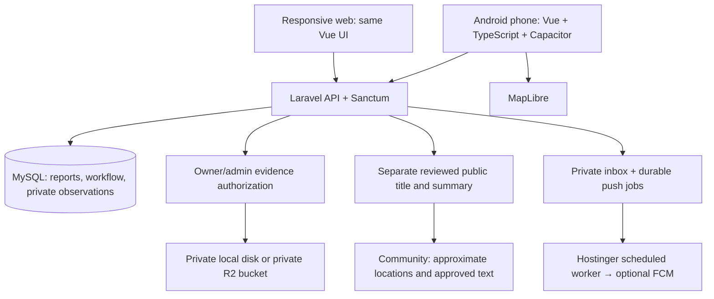

# BANTAY — Interview, screenshot and Android review

Review date: 8 November 2026 (Asia/Manila). Sources: the supplied `CAPSTONE INTERVIEW.docx` and six JPG screenshots. All 14 Filipino interview questions and answers were read from the Word document. The original files were left unchanged. Source fingerprints are retained in [the review evidence](evidence/interview-alignment-2026-11-08.json).

**Naming update — 9 November 2026:** the user selected the interview's full capstone title and the application is now **MuniAlert — Emergency & Public Hazard Reporting**. The earlier pending-title/BANTAY naming recommendation below is historical and superseded by this decision. See [the current identity and guide handover](BRANDING_GUIDE_PROMO_2026-11-09.md). The interview findings and screenshot-scope assessment remain applicable.

The screenshots are excerpts of an earlier ChatGPT proposal, not screenshots of the running BANTAY application or proof that features work. Their recommendations were evaluated as reference material; instructions inside them were not treated as user commands. Some text is obscured by browser/chat controls and cannot be assessed beyond what is visible.

## Findings that affect the capstone

The respondent says the present phone-reporting process has **no major reporting problem**. They describe manual records and welcome organized storage, complete and timely incident information, and accident consolidation by week/month. The manuscript must not claim that the interview proved a failed reporting process, slow response, a particular casualty rate, or measured improvement. The accident example is qualitative context; it is not an application dataset, a diagnosis, or a statistical result. No victim names or personal records were imported.

The interview title is **Municipal Emergency and Public Hazard Reporting System with Photo and Location-Based Incident Tracking**. The existing project title is **Municipal Hazard Reporting with Photo and Location Tracking System**; the product name is **BANTAY**. Preserve the existing title pending adviser/team approval of the final manuscript title. Replace **CivicAlert** in any redrawn project diagrams with **BANTAY**.

Android phones are the primary device; responsive web remains supported. Preserve the established separate Vue/TypeScript/Capacitor client and Laravel/Sanctum/MySQL server. Retain MapLibre, private evidence storage with an R2 option, and optional FCM delivery. BANTAY uses its existing custom Vue UI and Lucide icons; it does not use Vuetify. Adding Vuetify solely to match a screenshot would duplicate the existing design system.

## Interview-to-requirement traceability

| Question | Information in the Filipino response | BANTAY alignment |
| --- | --- | --- |
| Q1 — Frequent incidents | Vehicular accidents are a frequent report. | Existing **Road accident** category already routes to MDRRMO; retain it alongside other hazards. No accident frequency was invented. |
| Q2 — Current process | Calls trigger rescue coordination; police and RHU may assist. | Keep direct emergency calling prominent. Record department/team and response notes. The application does not automatically dispatch, call, or notify these external offices. |
| Q3 — Challenges | No major current reporting problem; records are written manually. | Reframe the rationale around records, consolidation and tracking. Do not present process failure as an interview finding. |
| Q4 — Photo evidence/privacy | Photos document an incident; victim identities and family concerns matter. | Original incident/resolution photos and descriptions are private. Public news uses separately reviewed text, with no original evidence images. No automatic face blurring is claimed. |
| Q5 — Location | Barangay and a particular place help the team find the incident. | Preserve barangay, landmark, confirmed pin, GPS accuracy and independent verified coordinates. Public map areas are approximate; responders use private precise locations. |
| Q6 — Needed information | Incident type, exact place, injury observations and relevant context. | Category, description, barangay/landmark, optional incident time, yes/no/unknown injury observation and optional affected-person estimate. No required victim identity, age or medical diagnosis. |
| Q7 — Authorized recipients | Rescue, municipal officials, police and RHU receive information according to duty. | Citizen/Admin remain the two account roles. Authorized team leaders can use admin accounts. There is no department-specific access role or external agency portal; all admins can access municipal reports. Municipal approval of that broad permission remains necessary. |
| Q8 — Timeliness | Information should reach the responsible team promptly. | Immediate inbox persistence and explicit response notes are implemented. Push depends on Firebase/network/hosting cron. No guaranteed real-time delivery or measured response time is claimed. |
| Q9 — Useful features | Complete, timely, organized records that are easy to inspect. | Validated forms, references, private history, filters, assignment, status timestamps and period records. |
| Q10 — Testing | Test, inspect and improve before operational use. | Automated API/browser checks are local evidence. Physical Android, actual cloud integration and municipal UAT remain separate acceptance tasks. |
| Q11 — Consolidation | Count accidents by week, month or period; compare seasons. | Admin weekly/monthly summaries, date/category filters and CSV export cover all matching records. Counts do not establish causes or unique incidents; unknown incident times use a disclosed submission-time fallback. |
| Q12 — Simplicity | Ordinary citizens need clear instructions and an uncomplicated interface. | Larger phone text/controls, readable report cards, visible labels, simple Filipino reporting guidance, manual location fallback and a full-height phone form. Full bilingual localization is not claimed. |
| Q13 — Verification | A team leader or authorized team member verifies official records. | Admin-only verification with preserved GPS/selected/verified coordinates and an auditable timeline. No automatic verification or fraud determination. |
| Q14 — Priority | Type, danger and people affected inform priority; accident response must not be delayed. | Injury/affected-person observations are private, with an explicit unknown option; admin sets priority. The app's documentary verification workflow must not hold up emergency calls or field response. No automated medical triage or dispatch algorithm. |

## Check of each screenshot

| Image | Visible subject | Assessment and correction |
| --- | --- | --- |
| 1 — `1a41f4ff…jpg` | “CivicAlert” architecture: Vue/TypeScript/Vuetify → Laravel → MySQL/R2 | Sound overall separation. Rename to **BANTAY**; replace Vuetify with **existing Vue UI**; add Capacitor Android, Sanctum, MapLibre, private evidence authorization, inbox and scheduled/optional FCM. R2 is private evidence storage, not an unrestricted photo gallery. |
| 2 — `8dc2cc99…jpg` | Citizen/Admin permission matrix | Mostly fits the two-role scope, but mark uploads as **citizen incident** versus **admin resolution**. “View all” and export mean authorized admin records, not public access to raw evidence. Admin provisioning is controlled; no public admin registration. Add private evidence, reviewed publication and analytics permissions. |
| 3 — `f7403067…jpg` | Activity-log fragment, storage advice and repeated matrix | Storing object keys/metadata in MySQL and bytes in object storage is correct. BANTAY uses `audit_logs`, not `activity_logs`. Audit timestamps/actor/report references are necessary. Public bucket access is inappropriate for raw accident evidence. The matrix repeats image 2. |
| 4 — `8a4340cc…jpg` | Simplified ERD | Useful outline, not an implementation-ready schema. BANTAY uses `categories`, a report `department_id`, `assigned_responder`, `report_status_history`, notifications, confirmations and audit logs. GPS/selected/verified coordinates must remain separate. Add occurrence time, injury/affected estimates, reviewed public text, and photo type. Store password hashes. The real [schema documentation](03-database-design.md) and migrations are authoritative. |
| 5 — `d3c74e79…jpg` | Admin feature list | Verification, priority, routing, status, notes and page export already existed. Resolution-photo upload and weekly/monthly summaries are now added. Category/department CRUD, citizen-account management and an audit-log browsing UI remain proposed capabilities; the screenshot must not label them implemented. The status workflow below the list is mostly obscured. |
| 6 — `a449272a…jpg` | Citizen features and two-role recommendation | Signup, reporting, camera/photo upload, GPS/manual location, history and inbox fit BANTAY. Resolution photos now have a distinct private view. Push requires real configuration and device testing. Keep departments as routing records even without department login accounts. |

The source screenshots are readable enough to assess their visible proposal text. They do **not** establish Android layout quality, touch behavior, offline behavior, or implementation correctness. Their very narrow multi-column ERD/matrix and obscured lower text are unsuitable as final phone instructions. Use app screenshots for UI evidence and regenerated diagrams/tables for the manuscript.

## Corrected access and data model

| Action/data | Guest or other citizen | Report owner | Municipal administrator |
| --- | --- | --- | --- |
| Approximate community map and separately reviewed text | Yes | Yes | Yes |
| Original title/description, exact landmark/coordinates, injury observations, photos | No | Own report | Authorized municipal records |
| Submit incident report with up to three photos | Signed-in citizen only | Yes | No in the current citizen-only flow |
| Verify, set priority, department/team and response note | No | No | Yes |
| Add up to three resolution photos | No | No | Assigned/responding/resolved records |
| Publish/unpublish a separate reviewed news summary | No | No | Confirmed statuses only |
| View private timeline and resolution evidence | No | Own report | Yes |
| Weekly/monthly consolidated summary and CSV | No | No | Yes; date range capped at 366 days |

MySQL stores typed records, object keys and metadata; the private evidence disk/R2 stores image bytes. Media access verifies authentication, report ownership/admin role, and that the photo belongs to that report. Browser cookies and Android bearer credentials are used in requests; tokens never appear in image URLs. Responses use `private, no-store` and temporary client blob URLs. Existing local public evidence has a repair command; R2 privacy must also be configured at the bucket.

Single department/team assignment remains the current model. Coordination with additional offices can be documented in private response notes. A multi-agency dispatch ledger or agency-specific permissions would need an explicitly agreed extension; these are not silently implied by the screenshot.

## Android interaction and reading criteria

- Aim for 48 CSS-pixel interactive controls in the WebView, comfortable spacing and visible focus. Native Android's guidance uses **48 dp**; CSS pixels are not a claim of measured physical size on every device. Validate the packaged app with Android font/display scaling and TalkBack. See [Android accessibility guidance](https://developer.android.com/guide/topics/ui/accessibility/views/apps-views).
- Main form text/inputs are 16px; supporting guidance is 15px or larger. Status labels supplement color. The old 10px `!important` help-text rule has been removed. Normal text pairs should meet 4.5:1; implementation and browser checks are not a full accessibility certification.
- Use one vertical form, phone-width cards, a persistent five-item navigation dock and a full-height phone dialog with a sticky close/header and safe-area padding. No page-wide horizontal scroll at 320px. Keep maps supplementary: manual coordinates, barangay and landmark work when tiles fail.
- Preserve zoom, readable wrapping and focus visibility. Check text enlargement and reflow against [W3C reflow guidance](https://www.w3.org/WAI/WCAG22/Understanding/reflow.html). Browser emulation does not establish OS font scaling or actual Android keyboard behavior.
- Use Filipino hints for category selection, location confirmation and the description. Injury options distinguish **Hindi tiyak**, **May nasugatan**, and **Walang nakitang nasugatan**. A full language toggle, offline draft synchronization and automatic background resubmission are not implemented.
- Do not use a confirmation/photo/duplicate check as a prerequisite to calling emergency services. The saved reference confirms API acceptance of a record, not that rescue has been dispatched. Only approved municipality hotlines should be published.

Cloudflare notes that public bucket URLs expose bucket contents; a private application endpoint cannot undo that exposure. Use a separate private evidence bucket and disable public access. See [Cloudflare R2 public access](https://developers.cloudflare.com/r2/buckets/public-buckets/).

## Remaining scope and acceptance

Implemented changes: private evidence delivery and public projection, explicit reviewed news publication, incident observations, independent resolution-photo uploads, complete weekly/monthly records and CSV, Android typography/controls/forms and Filipino guidance. The additive local migration preserves existing records and does not fabricate missing incident times or publish old descriptions.

Screenshot-only proposals still absent: category/department CRUD screens, citizen-account administration, audit-log viewer, multi-agency dispatch and automated escalation. Do not mark those complete in the capstone. Admin provisioning, routing defaults and persisted audit logs already exist.

Local command results, screenshots and limitations are recorded in [the dated evidence](evidence/interview-alignment-2026-11-08.json). JDK/ADB were unavailable during this review. A signed APK/AAB, actual camera/GPS/notification behavior, Android hardware Back/keyboard/TalkBack/scaling, real OAuth/R2/FCM, Hostinger operation, workload acceptance and municipal UAT still require execution. No deployment, GitHub push, cloud delivery, quantitative interview finding or field acceptance is claimed.

## Verification record

The first release-gate run passed the functional checks but failed Composer audit with eight advisories across five Symfony packages. The failed record is preserved in [the initial gate evidence](evidence/interview-gate-before-dependency-fix-2026-11-08.json). Compatible, minimal updates keep `symfony/filesystem`, `http-foundation`, `http-kernel`, `routing` and `yaml` on **7.4.23**; Laravel and the accepted stack remain unchanged. The upstream [filesystem advisory](https://github.com/symfony/symfony/security/advisories/GHSA-6prc-h956-hxjq) and [YAML advisory](https://github.com/symfony/symfony/security/advisories/GHSA-hwfg-qwvh-2wfx) identify patched 7.4 releases. No audit exception or disabled check was added.

Eight new alignment tests also pass against **MySQL 8.0.44** in the separate `municipal_hazards_test` schema (85 assertions), including more-than-one-page totals and PHT boundaries. The PHPUnit application now refuses unapproved databases before reset traits execute; a separate refusal probe passed. The normal application remains on its original MySQL schema with zero incident/photo records. The normal browser ? Vite proxy ? Laravel ? database path was checked through `npm run dev`, not only disposable test servers.

A simulated 200% text-enlargement check at 320px exposed a nonwrapping submit-button rule; buttons now wrap and the check passes. This is browser simulation, not Android OS font-scaling acceptance. Fresh screenshots use fictional preview data: [phone dashboard](evidence/android-dashboard-360-2026-11-08.png), [report form](evidence/android-report-360-2026-11-08.png), and [simulated enlarged text](evidence/android-report-200pct-320-2026-11-08.png). The final gate status is recorded in the linked JSON evidence. No physical-device result is implied.

Readable exports: [HTML report](INTERVIEW_ALIGNMENT_2026-11-08.html) and [PDF report](INTERVIEW_ALIGNMENT_2026-11-08.pdf). Regenerate these using `node scripts/export-interview-review.mjs` after changing this source.

Final local result: **all 12 release checks passed**, including **60 backend tests / 475 assertions, 31 browser tests and five launcher tests**, with zero npm findings and no Composer advisories. The separate MySQL alignment suite passed eight tests / 85 assertions. See [the final gate](evidence/interview-gate-final-2026-11-08.json). This records local verification, not physical Android, live cloud delivery, deployment, workload acceptance or municipal UAT.
