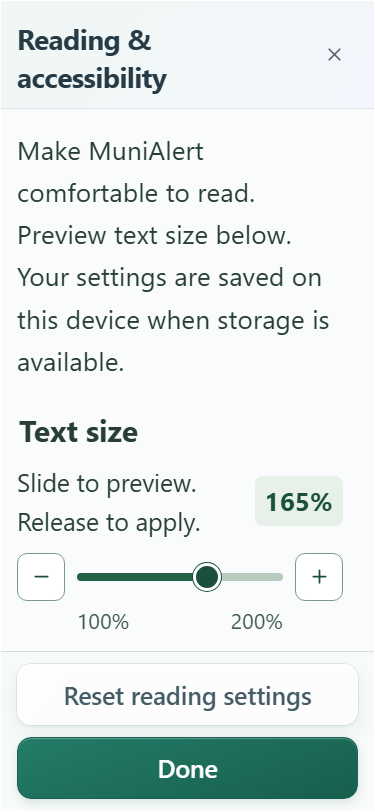

# Text-size slider and rolling dashboard counters

The 10 November request replaces reading-size buttons with a slider and gives dashboard numbers a lottery-machine rolling effect. Existing security, login, backgrounds and reading controls are preserved.

The native range spans 100–200% in 5% steps. A visible percentage, 48px minus/plus controls and native keyboard behavior make both directions accessible. Dragging updates the preview; release applies the app-wide size to keep the control steady during the gesture. Existing saved sizes remain supported. Valid intermediate values persist, and a `largeText` class applies responsive rules for every size from 150% upward. Reset and denied-storage behavior remain available.

`RollingNumber` provides clipped vertical digit columns, a few full rotations and staggered settling. Separators stay stationary, dashboard counts retain their two-digit minimum and screen readers receive the exact current value without hearing cycling digits. Reduced motion shows the final value immediately and cancels ongoing work. Updates/unmount cancel stale animations. The dashboard opts into reels through `AnimatedNumber`; incident-summary count-up behavior remains unchanged. Visual reel strips are not selectable, avoiding accidental copying of their repeated digits.

Local validation and final counts are recorded in [the evidence](evidence/slider-rolling-numbers-2026-11-10.json). The earlier full security/backend gate is historical; this UI follow-up uses relevant frontend/browser/build/documentation checks. Physical Android/TalkBack and actual-user acceptance remain pending. No push or deployment is included.

Final local results: **65 browser tests passed**, followed by **eight focused checks after percentage-badge polish**, plus type checking, native/web production builds, web packaging and Android asset synchronization. Both role manuals and the technical PDF were refreshed. This is scoped frontend verification; a future push still requires the full exact-state gate.

